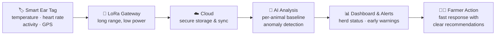

<div align="center">


# Terrava

### AI-Powered Smart Livestock Ecosystem

**Care Earlier. Manage Smarter. Grow More Sustainably.**

Terrava connects smart ear tags, IoT, the cloud, and artificial intelligence so farmers can monitor herd health, detect risks earlier, and make decisions grounded in data.

<p>
  🇬🇧 <b>English</b> &nbsp;|&nbsp; 🇮🇩 <a href="README-ind.md">Bahasa Indonesia</a>
</p>

<p>
  
  
  
  
</p>

<p>
  
  
  
  
  
  
  
  
  
  
  
  
</p>

<p>
  
  
  
</p>

<p>
  <a href="#-getting-started"><b>Getting Started</b></a> ·
  <a href="#-key-features"><b>Features</b></a> ·
  <a href="#-screenshots"><b>Screenshots</b></a> ·
  <a href="#-tech-stack"><b>Tech Stack</b></a> ·
  <a href="#-demo-accounts"><b>Demo Accounts</b></a>
</p>

<br />

<picture>
  <source media="(prefers-color-scheme: dark)" srcset="images/screenshots/dark/dashboard.png" />
  
</picture>

<sub>The image above follows your GitHub theme. Light and dark versions of every screen are in <a href="#-screenshots">Screenshots</a>.</sub>

</div>

---

## 📑 Table of Contents

- [About Terrava](#-about-terrava)
- [The Problem We Solve](#-the-problem-we-solve)
- [How It Works](#-how-it-works)
- [Key Features](#-key-features)
- [Smart Ear Tag](#-smart-ear-tag)
- [Screenshots](#-screenshots)
- [Tech Stack](#-tech-stack)
- [Project Structure](#-project-structure)
- [Getting Started](#-getting-started)
- [Demo Accounts](#-demo-accounts)
- [Environment Variables](#-environment-variables)
- [Demo Data and Storage](#-demo-data-and-storage)
- [Available Scripts](#-available-scripts)
- [Deployment](#-deployment)
- [Who Terrava Is For](#-who-terrava-is-for)
- [Sustainable Development Goals](#-sustainable-development-goals)
- [Roadmap](#-roadmap)
- [Team](#-team)
- [Acknowledgements](#-acknowledgements)
- [License](#-license)

---

## 🌱 About Terrava

**Terrava** is a smart livestock ecosystem that helps farmers watch over the health of every animal, 24 hours a day, without checking each one by hand.

A lightweight **smart ear tag** records each animal's body temperature, heart rate, activity, and location. The data travels over long-range **LoRa** connectivity to a gateway and then to the **cloud**, where **AI** learns each animal's normal pattern and flags anything unusual. Farmers see everything in one **web dashboard**: herd health, live vital signs, alerts with recommended first actions, farm maps, devices, teams, and downloadable reports.

> [!NOTE]
> This repository contains the **Terrava web platform**: the public website and the full farmer dashboard. It is a working **prototype**: every page and action works in the browser using a realistic dummy dataset, so the whole product can be explored without hardware or a backend.

<table>
  <tr>
    <td align="center" width="25%">🩺<br /><b>Detect earlier</b><br /><sub>Spot health risks before symptoms become visible</sub></td>
    <td align="center" width="25%">⏱️<br /><b>Save time</b><br /><sub>Replace manual animal-by-animal checks with continuous monitoring</sub></td>
    <td align="center" width="25%">📊<br /><b>Decide with data</b><br /><sub>Consistent health records, trends, and reports</sub></td>
    <td align="center" width="25%">🌍<br /><b>Farm sustainably</b><br /><sub>Healthier herds, fewer losses, better use of resources</sub></td>
  </tr>
</table>

---

## 🎯 The Problem We Solve

| Challenge on the farm | How Terrava responds |
| --- | --- |
| **Disease symptoms are detected too late.** Changes are only noticed once they are physically obvious. | Continuous vital-sign monitoring and AI anomaly detection surface risks at the earliest stage. |
| **Manual monitoring costs time and effort.** Checking animals one by one takes hours of labour. | Ear tags report automatically; the dashboard shows which animals need attention right now. |
| **Health data is recorded inconsistently.** Records are scattered and rarely organised. | Every animal has a digital profile with health history, treatment notes, and device status. |
| **Slow response drives losses higher.** Delayed treatment hurts productivity and income. | Smart alerts arrive with severity, an assignee, and a recommended first action. |

---

## ⚙️ How It Works

Six automated steps turn signals from every animal into decisions you can act on right away.



| Step | What happens |
| :---: | --- |
| 1️⃣ **Smart Ear Tag** | Records temperature, heart rate, activity, and location of each animal. |
| 2️⃣ **LoRa Gateway** | Relays data over long distances while using very little power. |
| 3️⃣ **Cloud** | Stores and synchronises data securely. |
| 4️⃣ **AI Analysis** | Learns each animal's normal pattern and flags anomalies before symptoms show. |
| 5️⃣ **Dashboard & Alerts** | Surfaces herd status, trends, and early warnings in one view. |
| 6️⃣ **Farmer Action** | The farmer responds fast, guided by clear recommendations. |

---

## ✨ Key Features

### 🌐 Public Website

| Page | What it offers |
| --- | --- |
| **Home** | Hero, partners, the problems farmers face, the six-step flow, core features, a dashboard preview, ear tag highlights, target users, prototype capabilities, pilot stories, and FAQ |
| **About** | Vision and mission, values, recognition, the team, and SDG contribution |
| **Solutions** | Eight solutions, each with its problem, Terrava's answer, capabilities, and benefit |
| **Smart Ear Tag** | Product overview, sensors, device anatomy, connectivity, energy, comfort and safety, data flow, and specifications |
| **How It Works** | The data journey, technical workflow, the farmer journey, user roles, and platform access |
| **Impact** | Impact pillars (animal health, productivity, food security, sustainable farming), charts, SDGs, and long-term vision |
| **Contact** | Contact options, contact form, and FAQ |
| **Auth** | Login (with one-click demo accounts), multi-step registration, forgot/reset password, onboarding |

### 🖥️ Farmer Dashboard

| Module | Highlights |
| --- | --- |
| 🏠 **Dashboard Overview** | Personal greeting, herd KPIs, health trend, health distribution, alert frequency, activity, device uptime, panels for alerts, animals needing attention, device issues, AI recommendations, and tasks. **Export Overview** downloads a PDF summary. |
| 🐄 **Livestock** | Searchable, filterable table with bulk actions and CSV export. Detail page with tabs for Overview, Vital Signs, Health Records, Alerts, Location, Device, and Activity Timeline. Add or edit animals (unique ID check, photo upload, ear tag pairing, saved drafts), move to another barn, and archive or restore. |
| 💓 **Live Monitoring** | Vital signs that refresh every few seconds, flags for animals past your alert thresholds, card or table view, pause/resume, and a full-screen **Control Room Mode**. |
| 🚨 **Alerts Center** | Filter by severity, category, and status. Acknowledge, resolve, reopen, or assign alerts one by one or in bulk. Each alert has notes, a timeline, related alerts, and **Create Task**. |
| 🧠 **AI Insights** | Insights by category and priority, risk trend, action completion. Mark as reviewed, dismiss (with undo), or turn an insight into a task. |
| 🗺️ **Farm Map** | Livestock pins colour-coded by health, barns, gateways, geofences, map/satellite layers, status filters, "show all", and a synced livestock list that flies to each animal. |
| 🏡 **Farms and Barns** | Add and edit farms, add barns, and see occupancy, health, and device statistics per farm. |
| 📡 **Devices** | Ear tags and gateways with battery, signal, and firmware. Restart, run diagnostics, start or end maintenance, pair with livestock, and review the event log. |
| 👥 **Team and Staff** | Invite members, change roles and farm assignments, deactivate or remove members (with protection for yourself and the last Owner). |
| 📈 **Reports and Analytics** | Ten charts driven by live filters. A library of six reports (health, alerts, devices, farm operations, environment/THI, staff) that you can **preview**, download as a real **PDF** or **CSV**, and **schedule**. Every download is kept in the report history. |
| ⚙️ **Settings** | Profile (with photo), Farm Settings, Notifications, Alert Thresholds, Appearance (theme, compact mode, sidebar), Security (password change), and Data and Privacy (JSON export, reset demo data, delete account). |

### 🧩 Across the Whole App

- 🌗 **Light and dark mode**: follows the system or your choice, applied before first paint so there is no flash.
- 🌏 **Bilingual**: full Indonesian and English translations, switchable from any page.
- 📱 **Responsive**: designed for phones, tablets, and large control-room screens.
- 📲 **Installable PWA**: works offline, caches the app shell and map tiles, and prompts when a new version is available.
- 🔎 **Global search** with <kbd>Ctrl</kbd> + <kbd>K</kbd>, a help drawer with <kbd>?</kbd>, a notification centre, and breadcrumbs.
- 🧭 **Header filters**: the farm and date-range selectors change the data on the dashboard overview.
- 🔐 **Protected routes**: dashboard pages require sign-in; sessions can be remembered.
- ♿ **Accessible**: semantic markup, keyboard focus states, and reduced-motion support.
- 🖨️ **Print-friendly**: dashboard pages print without navigation chrome.

---

## 🏷️ Smart Ear Tag

The Terrava smart ear tag is engineered for low power draw. It gathers physiological, activity, and location data without disturbing the animal.

<div align="center">
  
  
</div>

<br />

| Component | Specification |
| --- | --- |
| 🧠 MCU | Low-power 32-bit microcontroller |
| 🌡️ Temperature sensor | Digital body temperature sensor |
| ❤️ Heart rate sensor | Optical heart rate and oxygen sensor |
| 🏃 Motion sensor | 6-axis accelerometer and gyroscope |
| 📍 GPS | Low-power GPS module |
| 📡 Connectivity | LoRa long-range wireless |
| 💾 Memory | External flash storage (buffers data before upload) |
| 🔋 Battery | Rechargeable low-power battery, 60–80 days without solar (target) |
| ☀️ Solar panel | Optional solar-assisted charging |
| ⏲️ Data interval | Configurable periodic transmission |

---

## 📸 Screenshots

Every screen is shown in both themes. Screens were captured at 1440 × 900 with the interface in English.

<table>
  <tr>
    <th width="50%">☀️ Light Mode</th>
    <th width="50%">🌙 Dark Mode</th>
  </tr>
  <tr><td colspan="2" align="center"><b>Landing Page</b></td></tr>
  <tr>
    <td></td>
    <td></td>
  </tr>
  <tr><td colspan="2" align="center"><b>Login with Demo Accounts</b></td></tr>
  <tr>
    <td></td>
    <td></td>
  </tr>
  <tr><td colspan="2" align="center"><b>Dashboard Overview</b></td></tr>
  <tr>
    <td></td>
    <td></td>
  </tr>
  <tr><td colspan="2" align="center"><b>Livestock List</b></td></tr>
  <tr>
    <td></td>
    <td></td>
  </tr>
  <tr><td colspan="2" align="center"><b>Livestock Detail</b></td></tr>
  <tr>
    <td></td>
    <td></td>
  </tr>
  <tr><td colspan="2" align="center"><b>Live Monitoring</b></td></tr>
  <tr>
    <td></td>
    <td></td>
  </tr>
  <tr><td colspan="2" align="center"><b>Alerts Center</b></td></tr>
  <tr>
    <td></td>
    <td></td>
  </tr>
  <tr><td colspan="2" align="center"><b>AI Insights</b></td></tr>
  <tr>
    <td></td>
    <td></td>
  </tr>
  <tr><td colspan="2" align="center"><b>Farm Map and Tracking</b></td></tr>
  <tr>
    <td></td>
    <td></td>
  </tr>
  <tr><td colspan="2" align="center"><b>Reports and Analytics</b></td></tr>
  <tr>
    <td></td>
    <td></td>
  </tr>
  <tr><td colspan="2" align="center"><b>Report Library (PDF, CSV, and Scheduling)</b></td></tr>
  <tr>
    <td></td>
    <td></td>
  </tr>
  <tr><td colspan="2" align="center"><b>Report Preview</b></td></tr>
  <tr>
    <td></td>
    <td></td>
  </tr>
  <tr><td colspan="2" align="center"><b>Device Management</b></td></tr>
  <tr>
    <td></td>
    <td></td>
  </tr>
  <tr><td colspan="2" align="center"><b>Smart Ear Tag Page</b></td></tr>
  <tr>
    <td></td>
    <td></td>
  </tr>
</table>

<details>
<summary><b>📱 Mobile view</b> (click to expand)</summary>
<br />

<table>
  <tr>
    <th>☀️ Landing</th>
    <th>☀️ Dashboard</th>
    <th>🌙 Landing</th>
    <th>🌙 Dashboard</th>
  </tr>
  <tr>
    <td></td>
    <td></td>
    <td></td>
    <td></td>
  </tr>
</table>

</details>

---

## 🛠️ Tech Stack

| Layer | Technology |
| --- | --- |
| **Framework** | [React 18](https://react.dev/) + [TypeScript 5.8](https://www.typescriptlang.org/) |
| **Build tool** | [Vite 6](https://vite.dev/) |
| **Styling** | [Tailwind CSS 3.4](https://tailwindcss.com/), `tailwindcss-animate`, `class-variance-authority`, `tailwind-merge` |
| **Animation** | [Framer Motion 12](https://motion.dev/) (respects reduced-motion settings) |
| **Routing** | [React Router 7](https://reactrouter.com/) with protected dashboard routes |
| **Forms and validation** | [React Hook Form 7](https://react-hook-form.com/) + [Zod 4](https://zod.dev/) |
| **Tables** | [TanStack Table 8](https://tanstack.com/table) |
| **Charts** | [Recharts 3](https://recharts.org/) |
| **Maps** | [Leaflet 1.9](https://leafletjs.com/) + [React Leaflet 4](https://react-leaflet.js.org/) with CARTO, OpenStreetMap, and Esri World Imagery tiles |
| **Reports** | [jsPDF 4](https://github.com/parallax/jsPDF) + [jspdf-autotable 5](https://github.com/simonbengtsson/jsPDF-AutoTable) (loaded on demand), CSV export |
| **Icons and UI** | [Lucide](https://lucide.dev/), Radix UI primitives, shadcn/ui patterns |
| **Notifications** | [react-hot-toast](https://react-hot-toast.com/) |
| **Dates** | [date-fns 4](https://date-fns.org/) |
| **PWA** | [vite-plugin-pwa](https://vite-pwa-org.netlify.app/) + Workbox |
| **Quality** | ESLint 9, `typescript-eslint`, React Hooks lint rules |
| **Hosting** | [Vercel](https://vercel.com/) (SPA rewrites in `vercel.json`) |

---

## 🗂️ Project Structure

```text
Terrava/
├── frontend/                    # Terrava web platform (React + Vite)
│   ├── public/
│   │   ├── icons/               # PWA and favicon icons
│   │   └── Images/              # Product photos, mockups, team photos
│   ├── src/
│   │   ├── components/
│   │   │   ├── auth/            # Login, register, demo account card
│   │   │   ├── charts/          # Recharts wrappers
│   │   │   ├── dashboard/       # Layout, header, sidebar, tables, modals, panels
│   │   │   ├── devices/ farms/ livestock/ reports/ settings/ team/
│   │   │   ├── layout/          # Public navbar and footer
│   │   │   ├── sections/        # Landing and marketing page sections
│   │   │   ├── pwa/             # Install and update prompts
│   │   │   └── ui/              # Base UI primitives
│   │   ├── context/             # Auth, Theme, Language, Settings, Data Store, Dashboard
│   │   ├── data/                # Seeded demo datasets and website content
│   │   ├── hooks/               # Reusable hooks (data store, reports, devices, settings…)
│   │   ├── i18n/                # Indonesian and English dictionaries
│   │   ├── lib/                 # Reports, PDF/CSV export, map tiles, scheduling
│   │   ├── pages/               # Public, auth, and dashboard pages
│   │   ├── schemas/             # Zod validation schemas
│   │   ├── types/               # Shared TypeScript types
│   │   └── utils/               # Time, images, map icons, live readings
│   ├── .env.example             # Map API key template
│   ├── vercel.json              # SPA rewrites for Vercel
│   ├── vite.config.ts           # Vite, path alias, and PWA configuration
│   └── README.md                # Frontend technical notes
├── images/                      # Logo and README screenshots (light/ and dark/)
├── README.md                    # Documentation (English)
└── README-ind.md                # Documentation (Bahasa Indonesia)
```

---

## 🚀 Getting Started

### Prerequisites

- [Node.js](https://nodejs.org/) **18 or newer** (20 LTS recommended)
- npm (bundled with Node.js)
- Git

### Installation

```bash
# 1. Clone the repository
git clone https://github.com/StyNW7/Terrava.git

# 2. Open the frontend folder
cd Terrava/frontend

# 3. Install dependencies
npm install

# 4. (Optional) add a map API key, see "Environment Variables"
cp .env.example .env.local

# 5. Start the development server
npm run dev
```

Open **http://localhost:5173**, click **Try the Demo Dashboard** or **Login**, and sign in with a demo account.

> [!TIP]
> The app works out of the box with no configuration. Without a map key, the Farm Map simply uses OpenStreetMap tiles.

### Try the PWA locally

The service worker is only generated in production builds:

```bash
npm run build
npm run preview
```

Chrome and Edge on desktop or Android offer **Install**. On iOS, use Safari → Share → **Add to Home Screen**.

---

## 🔑 Demo Accounts

The prototype ships with dummy accounts. Each one signs straight in to the farmer dashboard, or use **Sign in instantly** on the login page.

| Persona | Email | Password |
| --- | --- | --- |
| 👨‍🌾 Farm Owner | `demo@terrava.id` | `Terrava123` |
| 🧑‍💼 Farm Manager | `manager@terrava.id` | `Terrava123` |
| 🩺 Veterinarian | `vet@terrava.id` | `Terrava123` |

> [!IMPORTANT]
> These credentials are for demonstration only. Authentication runs in the browser; there is no real user database yet.

---

## 🔐 Environment Variables

Create `frontend/.env.local` (git-ignored) from `frontend/.env.example`.

| Variable | Required | Purpose |
| --- | :---: | --- |
| `VITE_CARTO_API_KEY` | Optional | CARTO basemaps for the light and dark Farm Map without the "API KEY REQUIRED" watermark. Get a free key at [carto.com/basemaps/apikey](https://carto.com/basemaps/apikey). |
| `VITE_ARCGIS_API_KEY` | Optional | Only needed if you move the satellite layer to an ArcGIS Location Platform plan. |

**Keeping the map key safe**

1. In the CARTO dashboard, restrict the key to your domains (for example `localhost` and your Vercel domain). Map keys are always visible in browser requests, so the domain lock is what protects them.
2. Keep the key in `.env.local`, which is never committed.
3. On Vercel, add the variable under **Project → Settings → Environment Variables** and redeploy.

Map credits for OpenStreetMap, CARTO, and Esri stay visible as a small attribution chip, as their licences require.

---

## 💾 Demo Data and Storage

Terrava runs on a seeded, realistic dataset so every feature can be tried right away:

| Dataset | Amount |
| --- | --- |
| 🏡 Farms | 4 farms (Green Valley Farm, Lembang Dairy Farm, Nusantara Livestock Center, Terrava Demo Farm), each with barns |
| 🐄 Livestock | 40 animals with vital signs, health records, vaccinations, and locations |
| 📡 Devices | 20 devices (smart ear tags and gateways) with event and maintenance logs |
| 🚨 Alerts | 18 alerts across health, behaviour, location, device, environment, and weather |
| 🧠 AI insights | Insights with priority, confidence, and recommended actions |
| 👥 Team | 9 members with roles and farm assignments |

Every action (resolving alerts, adding livestock, inviting members, creating tasks, and so on) updates a shared store, so the change shows up on every page. Data is saved in the browser's `localStorage`:

| Key | Content |
| --- | --- |
| `terrava-demo-data` | Livestock, alerts, devices, farms, team, tasks, insights, report history, and schedules |
| `terrava-settings` | User settings (thresholds, units, notifications, appearance, and more) |
| `terrava-auth-session` | The signed-in session |
| `terrava-theme` / `terrava-language` | Theme and language preference |
| `terrava-password-overrides` | Passwords changed in Settings, stored as SHA-256 hashes |

To start fresh, open **Settings → Data and Privacy → Reset Demo Data**.

> [!NOTE]
> Because there is no backend yet, scheduled reports, email/WhatsApp notifications, team invitations, and the contact form are simulated in the browser. No messages are actually sent.

---

## 📜 Available Scripts

Run these inside the `frontend/` folder.

| Command | Description |
| --- | --- |
| `npm run dev` | Start the Vite development server with hot reload |
| `npm run build` | Type-check with TypeScript and build for production into `dist/` |
| `npm run preview` | Serve the production build locally (includes the service worker) |
| `npm run lint` | Run ESLint across the project |

---

## ☁️ Deployment

Terrava is a static single-page app and deploys well to **Vercel**:

1. Import the repository in Vercel.
2. Set **Root Directory** to `frontend`.
3. Framework preset: **Vite**. Build command `npm run build`, output directory `dist`.
4. Add `VITE_CARTO_API_KEY` (optional) under Environment Variables.
5. Deploy. `frontend/vercel.json` already rewrites every route to `index.html`, so deep links such as `/dashboard/alerts` work.

Any static host (Netlify, Cloudflare Pages, GitHub Pages with an SPA fallback) also works.

---

## 🤝 Who Terrava Is For

| Segment | Need |
| --- | --- |
| 🧑‍🌾 **Smallholder farmers** | An easier way to keep watch over their herd |
| 🏘️ **Livestock cooperatives** | Health data across many member farms |
| 🏭 **Commercial farms** | Management tools for large herds |
| 🏛️ **Government and veterinary institutions** | Aggregate data for animal health surveillance |

User roles in the Terrava platform: **Farmer**, **Farm Manager**, **Veterinarian**, **Cooperative Administrator**, and **Government or Institutional Viewer**.

---

## 🌍 Sustainable Development Goals

Terrava contributes to seven of the United Nations Sustainable Development Goals:

| SDG | Contribution |
| --- | --- |
| **2** · Zero Hunger | Food security through more consistently productive livestock |
| **3** · Good Health and Well-Being | Early detection of health risks for better animal welfare |
| **8** · Decent Work and Economic Growth | New opportunities in livestock technology and agritech |
| **9** · Industry, Innovation and Infrastructure | IoT and AI adoption in livestock infrastructure |
| **12** · Responsible Consumption and Production | More efficient and responsible farming practices |
| **13** · Climate Action | Resource efficiency and environmental monitoring |
| **15** · Life on Land | More sustainable management of grazing and farmland |

---

## 🗺️ Roadmap

- [x] Public website with product, solution, and impact pages
- [x] Bilingual interface (Indonesian and English) with light and dark themes
- [x] Farmer dashboard with livestock, monitoring, alerts, AI insights, map, farms, devices, team, and settings
- [x] Working PDF and CSV reports with preview, history, and scheduling
- [x] Installable PWA with offline support
- [ ] Backend API and database for real multi-user data
- [ ] Integration with physical smart ear tags over LoRaWAN
- [ ] Trained anomaly detection models on real herd data
- [ ] Real email and WhatsApp delivery for alerts and scheduled reports
- [ ] Cooperative and government aggregate dashboards

---

## 👩‍💻 Team

<table>
  <tr>
    <td align="center" width="200">
      <br />
      <b>Stanley Wijaya</b><br />
      <sub>Founder & Product Lead</sub><br />
      <a href="https://www.linkedin.com/in/stanley-nathanael-wijaya/">LinkedIn</a>
    </td>
    <td align="center" width="200">
      <br />
      <b>Aqnhatul Shabrina</b><br />
      <sub>Business Lead</sub><br />
      <a href="https://www.linkedin.com/in/aqnhatul-shabrina-341643320/">LinkedIn</a>
    </td>
  </tr>
</table>

---

## 🙏 Acknowledgements

- Map data © [OpenStreetMap](https://www.openstreetmap.org/copyright) contributors, basemaps by [CARTO](https://carto.com/attributions), satellite imagery by [Esri](https://www.esri.com/)
- Icons by [Lucide](https://lucide.dev/)
- Badges by [Shields.io](https://shields.io/)
- Everyone in the farming communities whose daily challenges inspired Terrava

---

## 📄 License

This repository does not include an open-source license yet, so all rights are reserved by the Terrava team. Please contact the team before reusing the code, design, or content.

<div align="center">

<br />


**Terrava** · AI-Powered Smart Livestock Ecosystem

<sub>Made with 💚 for farmers in Indonesia and beyond.</sub>

<a href="#terrava">⬆ Back to top</a>

</div>
