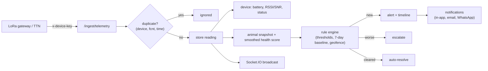

# Terrava Backend

REST + WebSocket API for the Terrava smart livestock platform, built with **NestJS 12**, **Prisma 7** and **PostgreSQL** (Neon, Supabase or any Postgres 14+).

It implements everything the dashboard prototype in `frontend/` does in the browser today — farms, livestock, live monitoring, alerts, AI insights, devices, team, reports, settings — as a real multi-tenant backend, plus the machine-to-machine endpoints the IoT layer (`iot/`) uses to push ear tag telemetry.

> This layer runs on its own. It is **not wired to the frontend, the AI service or the IoT layer yet**; the API contracts are designed so that wiring is a drop-in change later (see [Integration readiness](#integration-readiness)).

---

## Highlights

| Area | What you get |
| --- | --- |
| **Auth** | 3-step registration (account → farm → preferences) that provisions an organization, first farm and barn; JWT access tokens (15 min) + rotating opaque refresh tokens with **reuse detection**; remember-me; forgot/reset password by email; active sessions list and revoke; invitations |
| **Multi-tenancy & RBAC** | Every record belongs to an organization. Seven roles (Owner, Farm Manager, Operational, Staff, Veterinarian, Cooperative Admin, Viewer) with the exact permission matrix from the dashboard Team page, enforced by a global guard; last-Owner and self-change protection |
| **Farms & barns** | CRUD with **live statistics** (occupancy, capacity, health score, device coverage, open alerts, staff) computed from the records, geofences (polygons), climate history with Temperature-Humidity Index |
| **Livestock** | Every field of the Add Livestock form, unique ID checks, filters / sort / pagination, CSV export, bulk actions, archive / restore, barn moves with history, ear tag pairing, vital-sign series (hourly/daily buckets), location trail, health records (exam, vaccination, treatment, weighing), activity timeline |
| **IoT ingest** | Gateway API keys, batch telemetry, environment sensors, **The Things Network webhook**, heartbeats, downlink command queue (restart, diagnostics, report interval, firmware, locate) with acknowledgements, duplicate suppression by frame counter |
| **Rule engine** | Fever, hypothermia, tachycardia, low SpO₂, activity drop vs a 7-day per-animal baseline, geofence breach duration, low battery, weak signal, barn heat stress (THI), offline devices, heat-wave forecast. Organisation-wide thresholds from Settings. Alerts are **de-duplicated, escalated** when worse and **auto-resolved** when the condition clears |
| **Health model** | Deterministic health score (0–100) from vital signs, smoothed per reading; status bands healthy / attention / critical |
| **Alerts center** | Filters, stats (MTTR), acknowledge / resolve / reopen / assign (single + bulk), notes, full timeline, related alerts, alert → task |
| **AI insights** | Hourly herd analytics (activity decline per barn, recurring fever, battery trend, heat stress, falling herd health, overdue vaccinations, weak gateways); review, dismiss/undo, insight → task, 14-day risk trend; endpoint for model-generated insights |
| **Dashboard** | One call returns KPIs, health trend, distribution, alert frequency, activity trend, device uptime and every panel; global search (Ctrl + K); farm map layers |
| **Reports** | 7 bilingual reports (overview, health, alerts, devices, farm, environment/THI, staff) as JSON preview, **PDF** (branded, paginated) or **CSV**; history with re-download; **scheduled email delivery** with attachments; analytics endpoint for the 10 charts |
| **Notifications** | In-app (stored + pushed), email (SMTP) and WhatsApp (HTTP gateway) gated by each user's preferences; **Socket.IO realtime** (`/realtime`) for telemetry, alerts, devices, insights |
| **Operations** | Swagger UI, validation everywhere, unified error format, rate limiting, Helmet, CORS, audit log, health probe, cron jobs (offline detection, uptime, command expiry, retention, insights, schedules, weather) |

---

## Quick start (no Docker, no cloud account)

Requirements: **Node.js 22.12+** (24 LTS recommended).

```bash
cd backend
npm install
cp .env.example .env            # defaults work for local development

# Terminal 1 — embedded PostgreSQL on port 5433 (data in backend/.local-db)
npm run db:local

# Terminal 2
npm run db:deploy               # apply migrations
npm run db:seed                 # demo data identical to the frontend prototype
npm run dev                     # API on http://localhost:4000/api/v1
```

Open **http://localhost:4000/docs** for the interactive API reference, and sign in with a demo account:

| Persona | Email | Password |
| --- | --- | --- |
| Farm Owner | `demo@terrava.id` | `Terrava123` |
| Farm Manager | `manager@terrava.id` | `Terrava123` |
| Veterinarian | `vet@terrava.id` | `Terrava123` |

The seed also creates gateway **DEV-013** with the API key `trv_gw_demo_green_valley_key_change_me_0001`, so the IoT simulator can stream data immediately.

### Alternative databases

| Option | How |
| --- | --- |
| **Docker** | `docker compose up -d db` (same URL as the embedded database) |
| **Neon** | Create a project, put the *pooled* string in `DATABASE_URL` and the direct one in `DIRECT_URL` |
| **Supabase** | Project Settings → Database: transaction pooler (6543) in `DATABASE_URL`, session/direct (5432) in `DIRECT_URL` |

Then run `npm run db:deploy && npm run db:seed`.

---

## Scripts

| Command | Purpose |
| --- | --- |
| `npm run dev` | Start with hot reload |
| `npm run build` / `npm run start:prod` | Compile to `dist/` and run it |
| `npm run typecheck` | TypeScript check of the whole project |
| `npm test` | Unit tests (rule engine, health model, THI, geofence, scheduling, RBAC matrix, TTN mapping, CSV) |
| `npm run test:smoke` | End-to-end smoke test against a running, seeded API (25 scenarios) |
| `npm run db:local` | Embedded PostgreSQL for development |
| `npm run db:migrate` | Create a new migration after editing `prisma/schema.prisma` |
| `npm run db:deploy` | Apply migrations (CI / production) |
| `npm run db:seed` | Load the demo organization (safe to re-run) |
| `npm run db:studio` | Prisma Studio data browser |

---

## Project structure

```text
backend/
├── prisma/
│   ├── schema.prisma          # 28 models: tenancy, farms, livestock, devices, telemetry, alerts, reports...
│   ├── migrations/            # SQL migrations
│   ├── seed.ts                # demo organization + 7 days of telemetry history
│   └── seed-data.ts           # generators ported from the frontend (same seeds -> same data)
├── scripts/
│   ├── local-db.ts            # embedded PostgreSQL
│   └── smoke-test.ts          # end-to-end checks
├── src/
│   ├── main.ts                # bootstrap: Helmet, CORS, validation, Swagger
│   ├── app.module.ts          # global guards: throttle -> JWT -> permissions
│   ├── config/                # zod-validated environment
│   ├── prisma/                # PrismaClient on the pg driver adapter
│   ├── domain/                # pure logic: alert rules, health score, THI, geo, schedules, firmware
│   ├── common/                # RBAC matrix, decorators, guards, error filter, serializers, utils
│   └── modules/
│       ├── auth/  settings/  team/  audit/
│       ├── farms/  livestock/  devices/  tasks/
│       ├── telemetry/         # IoT ingest, TTN webhook, rule pipeline, device monitor jobs
│       ├── alerts/  insights/  dashboard/  reports/
│       ├── notifications/     # in-app, email, WhatsApp, Socket.IO gateway
│       └── weather/  contact/  health/
└── Dockerfile, docker-compose.yml
```

---

## API overview

Base URL `http://localhost:4000/api/v1`. Dashboard routes need `Authorization: Bearer <accessToken>`; IoT routes need `x-device-key: <gateway key>`. Full schemas are in Swagger (`/docs`).

| Module | Main endpoints |
| --- | --- |
| Auth | `POST /auth/register` `POST /auth/login` `POST /auth/refresh` `POST /auth/logout` `POST /auth/forgot-password` `POST /auth/reset-password` `POST /auth/accept-invitation` `GET /auth/me` `POST /auth/change-password` `GET /auth/sessions` |
| Dashboard | `GET /dashboard/overview?farmId&range` `GET /search?q` `GET /map` |
| Farms | `GET/POST /farms` `GET/PATCH/DELETE /farms/:id` `GET /farms/:id/environment` `GET /farms/:id/activity` `GET/POST /farms/:id/barns` `PATCH/DELETE /barns/:id` `GET /geofences` `POST /farms/:id/geofences` |
| Livestock | `GET/POST /livestock` `GET /livestock/export.csv` `GET /livestock/check-unique` `POST /livestock/bulk` `GET/PATCH/DELETE /livestock/:id` `POST /livestock/:id/{archive,restore,move}` `PUT /livestock/:id/device` `GET /livestock/:id/{vitals,location-history,alerts,health-records,weight-history,timeline}` |
| Telemetry | `GET /telemetry/live` `GET /telemetry/livestock/:id/latest` |
| Alerts | `GET/POST /alerts` `GET /alerts/stats` `POST /alerts/bulk` `GET /alerts/:id` `PATCH /alerts/:id/{acknowledge,resolve,reopen,assign}` `POST /alerts/:id/{notes,tasks}` |
| Insights | `GET /insights` `GET /insights/summary` `POST /insights/generate` `PATCH /insights/:id/{review,dismiss,restore}` `POST /insights/:id/tasks` |
| Devices | `GET/POST /devices` `GET /devices/stats` `GET/PATCH/DELETE /devices/:id` `POST /devices/:id/{restart,diagnostics,api-key,commands}` `POST /devices/:id/maintenance/{start,end}` `PUT /devices/:id/assignment` `GET /devices/:id/{events,readings,commands}` |
| Tasks | `GET/POST /tasks` `PATCH/DELETE /tasks/:id` |
| Team | `GET /team` `GET /team/permissions` `GET/POST /team/invitations` `PATCH/DELETE /team/:id` `POST /team/:id/{activate,deactivate}` |
| Reports | `GET /reports/types` `GET /reports/analytics` `GET /reports/:type/preview` `GET /reports/:type/download?format=pdf\|csv` `GET /reports/history` `GET/PUT/DELETE /reports/schedules/:type` |
| Settings | `GET /settings` `PATCH /settings/{profile,preferences,thresholds}` `GET /settings/export` `DELETE /settings/account` `GET/PATCH /organization` |
| Other | `GET /notifications` `GET /weather` `POST /contact` (public) `GET /health` (public) `GET /audit-logs` |
| **IoT ingest** | `POST /ingest/telemetry` `POST /ingest/environment` `POST /ingest/ttn` `POST /ingest/heartbeat` `GET /ingest/commands` `POST /ingest/commands/:id/ack` |

### Realtime

```js
const socket = io('http://localhost:4000/realtime', { auth: { token: accessToken } });
socket.on('telemetry', (reading) => {});      // live vitals for the Live Monitoring page
socket.on('alert:created', (alert) => {});    // notification bell, Alerts Center
socket.emit('subscribe:livestock', 'LVS-001'); // per-animal stream: 'telemetry:livestock'
```

Events: `telemetry`, `telemetry:livestock`, `environment`, `alert:created`, `alert:updated`, `device:updated`, `livestock:updated`, `insight:created`, `notification`.

---

## Telemetry pipeline



---

## Integration readiness

The backend is independent today, but the contracts are aligned with the other layers:

- **Frontend** — responses use the same field names and kebab-case values as `frontend/src/types/dashboard.ts` (`healthStatus: "attention"`, `deviceStatus: "low-battery"`, `assignedTo: "Budi Santoso"`, localized `{ id, en }` text). The seed reproduces the prototype's ids (`farm-1`, `LVS-001`, `DEV-001`, `ALT-001`...). Replacing `DataStoreContext` actions with API calls is a mechanical change.
- **IoT** — `/ingest/*` accepts exactly what `iot/bridge` and the TTN decoder in `iot/protocol` produce.
- **AI** — `POST /insights` stores model-generated insights in the dashboard's shape; the AI service's `/v1/health/score` and `/v1/anomaly/detect` can later replace `domain/health-scoring.ts` inside the telemetry pipeline.

## Deployment

1. Create a Neon or Supabase database and set `DATABASE_URL` / `DIRECT_URL`.
2. Set a strong `JWT_ACCESS_SECRET`, `APP_URL`, `CORS_ORIGINS`, and optionally SMTP / WhatsApp.
3. Deploy the Docker image (Railway, Render, Fly.io, Google Cloud Run, a VPS...). The container runs `prisma migrate deploy` before starting.
4. Run a single instance with `JOBS_ENABLED=true` (or move the jobs to a worker) — the in-memory caches and cron jobs assume one scheduler.
