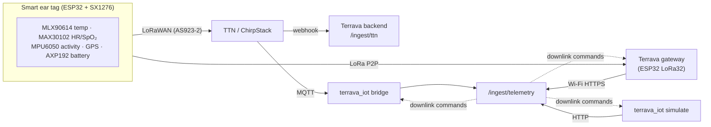

# Terrava IoT

Everything between the cow's ear and the cloud: the **smart ear tag firmware**, a **LoRa gateway**, the **payload protocol** shared by all of them, a **LoRaWAN bridge** for The Things Network / ChirpStack, and a **fleet simulator** that streams realistic data before hardware exists.

> Runs on its own. The simulator and bridge talk to the backend's `/api/v1/ingest/*` API only when you pass `--api`; nothing here depends on the AI layer or the frontend.



| Folder | What it is |
| --- | --- |
| [`protocol/`](protocol) | Binary payload spec v1 ([`PAYLOAD.md`](protocol/PAYLOAD.md)), header-only C codec, TTN/ChirpStack JavaScript formatter, shared test vectors |
| [`firmware/ear-tag/`](firmware/ear-tag) | PlatformIO / Arduino C++ firmware for the tag: sensors, LoRaWAN OTAA or P2P, deep sleep, flash buffering, downlink commands |
| [`firmware/gateway/`](firmware/gateway) | Single-channel LoRa → Wi-Fi gateway for pilots without LoRaWAN coverage |
| [`ear-tag-specifications/`](ear-tag-specifications) | Two 3D-printable ear tag enclosures, TV-ET1 Shield (flat, compact) and TV-ET0 Classic (dangle, solar): parametric CAD, STL/STEP, renders, drawings, 3D viewers, spec sheets |
| [`terrava_iot/`](terrava_iot) | Python package: codec, simulator, MQTT bridge with durable outbox, CLI |
| [`tests/`](tests) | 31 tests; the Python codec, the JS formatter and the vectors must agree byte for byte |

Both firmware projects build with PlatformIO (`tbeam-lorawan`, `tbeam-p2p`, `lora32`; ESP32 Arduino core 2.0.17). The host-side Unity tests (`pio test -e native`) need a local gcc/clang.

---

## Quick start (no hardware)

Requirements: Python 3.11+ (Node.js optional, for the formatter test).

```bash
cd iot
python -m venv .venv
# Windows: .venv\Scripts\activate    macOS/Linux: source .venv/bin/activate
pip install -r requirements-dev.txt
pip install -e . --no-deps
pytest
```

**Simulate on the console** (every reading is really encoded to the 22-byte LoRa payload and decoded back):

```bash
python -m terrava_iot simulate --scenario DEV-001=fever --duration 10
```

**Stream to a running backend** (seeded demo gateway key is the default), with 6 h of history first so per-animal activity baselines exist:

```bash
python -m terrava_iot simulate --api http://localhost:4000/api/v1 \
  --backfill 6 --speed 600 \
  --scenario DEV-001=fever --scenario DEV-003=respiratory --scenario DEV-005=geofence --hot
```

Within seconds the backend raises fever, tachycardia, low-SpO₂ and barn heat-stress alerts, and commands queued from the dashboard (`POST /devices/:id/commands`, e.g. `set-interval`) are executed by the virtual tags and acknowledged — the full uplink/downlink loop.

Scenarios: `normal`, `fever`, `heat-stress`, `respiratory`, `lameness`, `estrus`, `geofence`, `low-battery`, `offline`.

**Tools:**

```bash
python -m terrava_iot decode 110f19486140019cff8d153c0697a78154016ad30ee0   # payload -> JSON
python -m terrava_iot command set-interval --seq 3 --interval 600            # downlink bytes
```

---

## Payload protocol (summary)

| FPort | Message | Size | Contents |
| --- | --- | --- | --- |
| 1 | vitals | 22 B | temperature (0.01 °C), heart rate, SpO₂, activity, steps, GPS (1e-6°), battery, flags, sample timestamp |
| 2 | status | 13 B | firmware, uptime, report interval, battery, buffered readings, last command result |
| 3 | environment | 8 B | barn temperature and humidity |
| 10 | downlink | 2–5 B | restart, diagnostics, set-interval, locate, firmware-update |

Big-endian, versioned header, "not available" sentinels, a *replayed* flag for readings sent late from flash, and a CRC-16 P2P frame for gateway mode. Full table: [`protocol/PAYLOAD.md`](protocol/PAYLOAD.md).

---

## Ear tag firmware

Reference hardware: **LilyGO T-Beam v1.1/1.2** (ESP32, SX1276, u-blox GPS, AXP192 PMU, 18650 holder) plus I²C sensors **MAX30102** (heart rate + SpO₂), **MLX90614** (IR temperature, calibrated to core temperature) and **MPU6050** (activity and steps). The code is split into `sensors`, `radio`, `storage` and `main` so porting to a custom PCB (nRF52/STM32WL) only touches the drivers.

Cycle (default every 5 min, changeable over the air):

1. Measure temperature (8-sample average), heart rate/SpO₂ (Maxim algorithm, contact check) and a 10 s activity window.
2. GPS fix every 3rd cycle or on `locate`; GPS time keeps the RTC in sync for timestamps.
3. Send the vitals uplink; status uplink after boot, after every command and daily.
4. Apply downlinks: restart, diagnostics (sensor self-test), set-interval (30 s–24 h), locate (LED + immediate fix).
5. Out of coverage? Readings go to a LittleFS FIFO (≈ 7 days) and are replayed later, flagged as historical.
6. Deep sleep; the LoRaWAN session and counters live in RTC RAM so no re-join is needed.

```bash
cd firmware/ear-tag
cp include/secrets.example.h include/secrets.h   # DevEUI / JoinEUI / AppKey from TTN or ChirpStack
pio run -e tbeam-lorawan -t upload               # or -e tbeam-p2p for the Terrava gateway
pio device monitor
pio test -e native                               # protocol tests on the host (needs gcc)
```

Register the same **DevEUI** on the device in Terrava (Devices → Edit) so uplinks map to the right animal.

### LoRaWAN setup (production)

1. Create an application on The Things Stack (frequency plan **AS923-2**, Indonesia) or ChirpStack.
2. Register each tag (OTAA, LoRaWAN 1.1) and copy its keys into `secrets.h`.
3. Paste [`protocol/ttn-formatter.js`](protocol/ttn-formatter.js) as the payload formatter.
4. Either add a **webhook** to `POST https://<backend>/api/v1/ingest/ttn` with header `x-device-key: <gateway key>`, or run the MQTT bridge:

```bash
python -m terrava_iot bridge --network ttn --app terrava-farm \
  --mqtt-host au1.cloud.thethings.network --mqtt-user terrava-farm@ttn --mqtt-password NNSXS.... \
  --api https://<backend>/api/v1 --key trv_gw_... --sensor 70B3D57ED0005A20=DEV-017
```

The bridge decodes raw payloads itself, keeps undelivered readings in a SQLite outbox during backhaul outages, and converts backend commands into LoRaWAN downlinks.

## Gateway firmware (LoRa P2P)

For pilots without LoRaWAN coverage: a **TTGO LoRa32 v2.1** listens on one channel (921.4 MHz, SF9), validates frames (CRC-16), batches readings to the backend over Wi-Fi every 10 s, sends a heartbeat every minute, polls `/ingest/commands?scope=farm` and delivers commands in the tag's 2-second receive window.

```bash
cd firmware/gateway
cp include/secrets.example.h include/secrets.h   # Wi-Fi, backend URL, gateway API key
pio run -t upload && pio device monitor
```

---

## Power budget (target, T-Beam prototype)

| Phase | Current | Time per 5-min cycle |
| --- | --- | --- |
| Sensors (temp + HR + activity) | ~45 mA | ~15 s |
| GPS (every 3rd cycle) | ~35 mA | ~10 s avg |
| LoRa TX (SF9, 14 dBm) | ~120 mA | ~0.2 s |
| Deep sleep | ~0.01–1 mA (board-dependent) | rest |

A purpose-built tag (nRF52 + low-power sensors, sensor duty-cycling, solar assist) is what reaches the 60–80-day target in the product spec; the T-Beam is the development platform.
