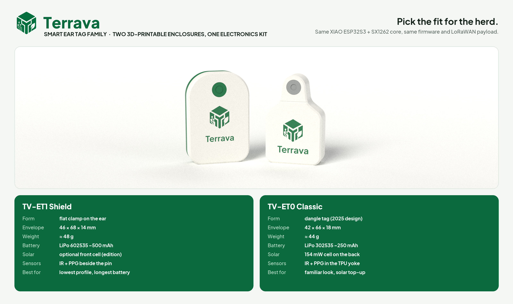

# Terrava Smart Ear Tag: dua desain siap cetak 3D

[🇬🇧 English](README.md)

Terrava punya dua casing smart ear tag. Keduanya tersegel, dicetak tanpa support, membawa paket elektronik yang sama, dan menjalankan firmware serta payload LoRaWAN yang sama. Perbedaannya ada pada cara tag duduk di telinga.

<p align="center"></p>

| | [**TV-ET0 Classic**](tv-et0-classic/README-ind.md) | [**TV-ET1 Shield**](tv-et1-shield/README-ind.md) |
| --- | --- | --- |
| Asal | desain Terrava asli 2025 ([referensi](references/Prototype-Terrava-Ear-Tag-v1.png)), dibangun ulang | desain ringkas baru (2026) |
| Bentuk | dangle tag: leher berujung bulat, bahu, badan lebar | "shield" datar, dijepit rata di telinga |
| Dimensi | 42 × 66 × 18 mm | 46 × 68 × 14 mm |
| Berat (lengkap) | ≈ 44 g | ≈ 48 g |
| Baterai | LiPo 302535 ≈ 250 mAh | LiPo 602535 ≈ 500 mAh |
| Surya | sel 154 mW di belakang, standar | opsional, sel depan 32 × 17 mm (edisi surya) |
| Sensor tubuh | PPG + IR di yoke TPU lunak di bawah pin | PPG + IR di kiri dan kanan pin |
| Casing | housing + cover, kait leher + 2 × M2 | shell belakang + depan, 4 × M2 |
| Daya tahan, profil lapangan | ≈ 22 hari tanpa matahari, netral energi di luar ruangan | ≈ 45 hari |
| Pilih jika | ingin tampilan tag yang familiar dan tambahan daya surya di padang | ingin profil paling tipis, baterai paling awet, kontak sensor paling stabil |

**Sama pada keduanya**

- **Elektronik:** Seeed XIAO ESP32S3 + Wio-SX1262 (LoRaWAN AS923-2), termometer IR MLX90614, PPG MAX30102, IMU 6-axis, GNSS kelas L76K dengan patch 18 mm, antena FPC LoRa, dan USB-C di balik sumbat TPU yang rata.
- **Pemasangan:** male button ear tag sapi standar, dikunci ring TPU yang bisa diganti, di sepertiga tengah telinga.
- **Cetak dan segel:** PETG atau ASA plus TPU 95A, inlay logo dua warna yang rata, lap joint dengan gasket TPU. Keduanya menargetkan IP67, yang masih perlu diuji.
- **Firmware:** keduanya butuh porting yang sama dari LilyGO T-Beam (SX1276) ke XIAO + SX1262. Caranya dijelaskan di tiap lembar spesifikasi; payload dan backend tidak berubah.

Setiap folder desain berisi kelengkapan yang sama:

- sumber CadQuery parametrik dengan pemeriksaan tabrakan dan berat;
- STL siap cetak serta file STEP dengan rakitan berwarna;
- render fotorealistis;
- tiga lembar gambar A3 (PNG + PDF);
- viewer 3D offline;
- lembar spesifikasi lengkap dalam bahasa Inggris dan Indonesia.

## Struktur folder

```
ear-tag-specifications/
├── README.md / README-ind.md        indeks ini
├── images/                          poster keluarga + render berdampingan
├── references/                      render konsep dan foto prototipe 2025 (sumber Classic)
├── tv-et0-classic/                  TV-ET0 Classic: README, cad/, models/, images/, viewer 3D
└── tv-et1-shield/                   TV-ET1 Shield: README, cad/, models/, images/, viewer 3D
```

Skrip Classic memakai ulang helper CAD, pencahayaan studio, kit gambar, font, dan trace logo milik Shield dari `tv-et1-shield/cad/`, jadi simpan kedua folder bersama-sama.
