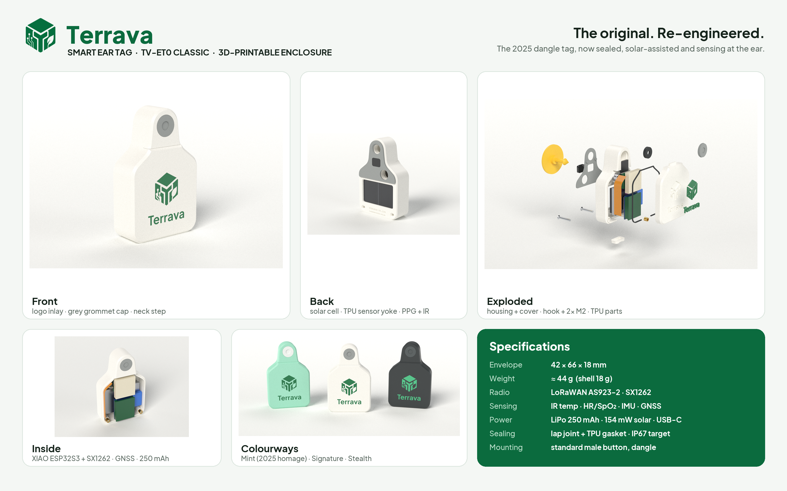
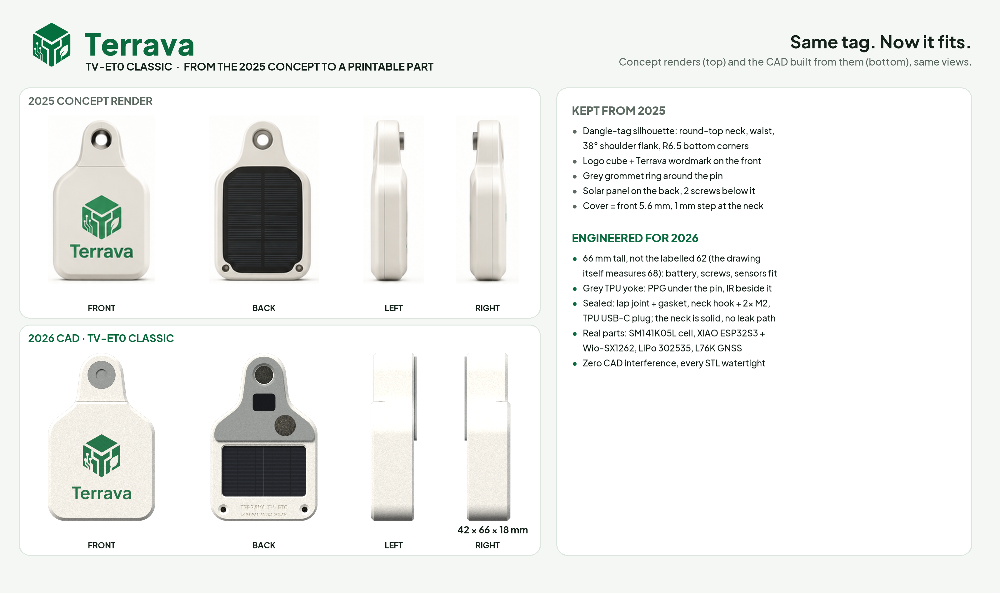
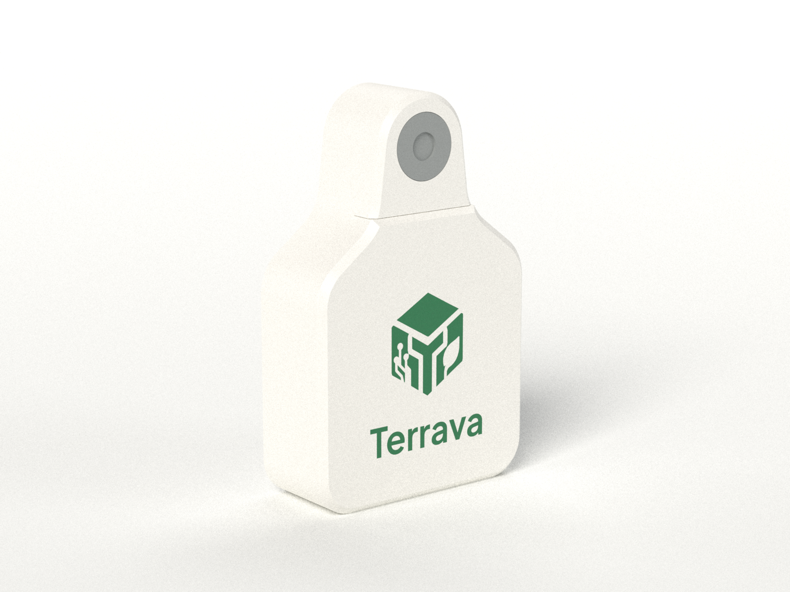
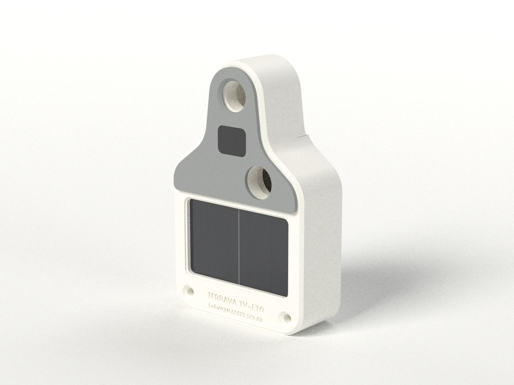
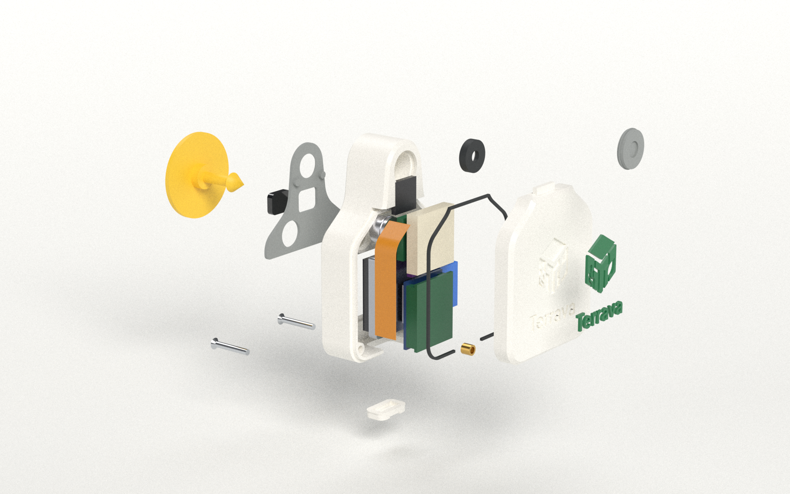
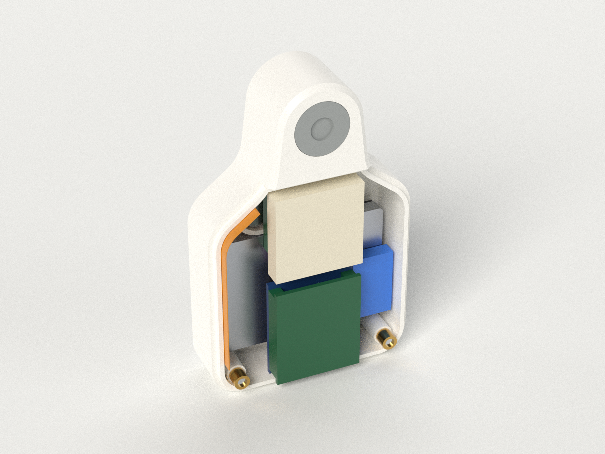
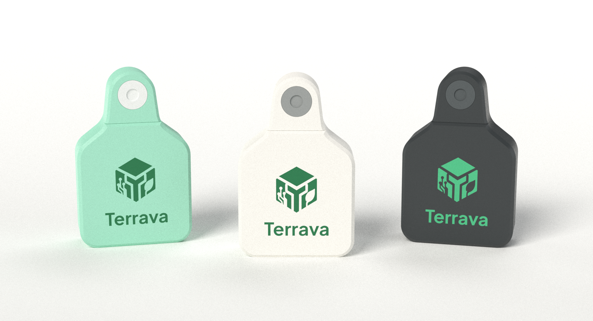
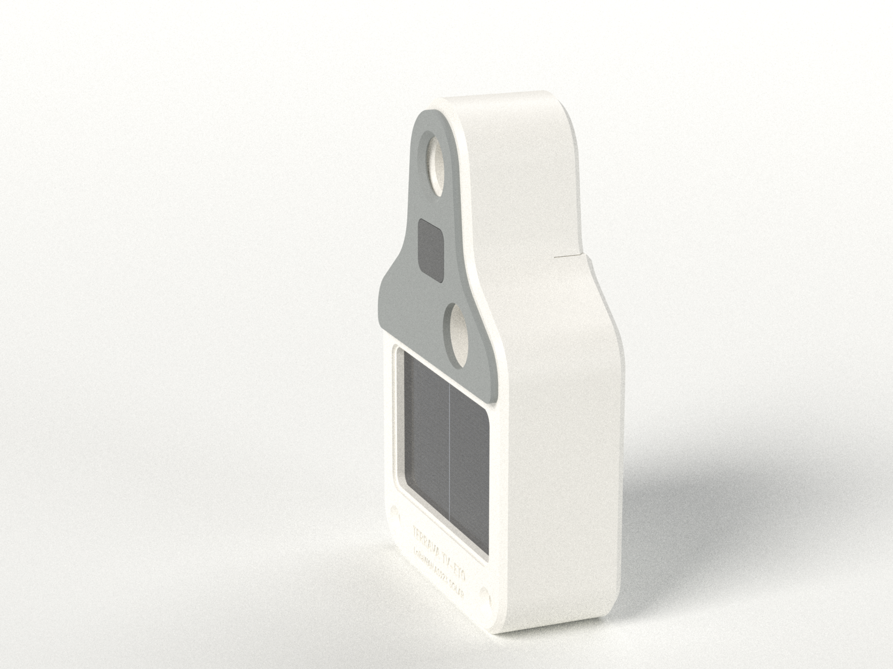

# Terrava Smart Ear Tag TV-ET0 Classic: spesifikasi casing

[🇬🇧 English](README.md) · Bagian dari [keluarga ear tag Terrava](../README-ind.md), bersama [TV-ET1 Shield](../tv-et1-shield/README-ind.md)

**Ear tag Terrava versi awal (2025)**, dibangun ulang dari render konsep dan foto prototipenya ([`references/`](../references/Prototype-Terrava-Ear-Tag-v1.png)) menjadi produk yang tersegel dan siap cetak 3D. Bentuk **dangle tag klasik** tetap dipertahankan (leher dengan ujung bulat, bahu, badan lebar), begitu juga **logo di depan** dan **panel surya di belakang**. Sekarang casing ini memuat paket IoT yang sama dengan Shield (ESP32-S3 + LoRa SX1262, suhu IR, PPG, IMU, GNSS), dipasang dengan **male button ear tag sapi standar**, dan bersifat *plug & use*: isi daya lewat USB-C, segel, daftarkan, pasang.

<p align="center"></p>

Semuanya berasal dari satu skrip CAD parametrik ([`cad/terrava_classic.py`](cad/terrava_classic.py)). File STL/STEP, render, gambar teknik, dan viewer 3D dihasilkan dari skrip itu, dan setiap komponen referensi diperiksa **tanpa tabrakan (zero interference)** terhadap housing dan cover.

---

## Dari konsep 2025 menjadi part siap cetak

<p align="center"></p>

Lembar konsep menuliskan ukuran **42 × 62 × 18 mm**, tetapi gambarnya tidak sesuai dengan labelnya sendiri. Jika diukur terhadap lebar 42 mm, tampak depan yang digambar setinggi **68 mm** dan tampak samping setebal 16 mm. CAD mempertahankan bentuk gambarnya dan memilih ukuran yang muat untuk elektroniknya:

| | Konsep (diukur dari render) | CAD TV-ET0 Classic |
| --- | --- | --- |
| Lebar | 42 mm | **42 mm** |
| Tinggi | label 62, gambar 68 | **66 mm**: di bawah 66, baterai, dua sekrup bawah, dan baris sensor tidak muat lagi |
| Tebal | label 18, gambar 16 | badan **17 mm** + yoke TPU **1 mm** = **18 mm** |
| Leher | ujung bulat sepusat dengan lubang, lebar ~17–19 mm | ujung **R8,6** sepusat dengan pin, lebar **17,3 mm** di pin, sisi melebar 7° ke bawah |
| Bahu | pinggang cekung → sisi miring lurus → bahu bulat | pinggang **R8** → sisi miring **37,6°** → bahu **R8**, lebar penuh mulai 32 mm dari atas |
| Sambungan | cover = bagian depan ≈ 5,6 mm, garis melintang di pangkal leher | cover **5,6 mm**, berakhir di pangkal leher dengan undakan 45° setinggi 1 mm |
| Belakang | panel surya gelap, dua sekrup di bawahnya, cincin abu-abu di lubang | sel surya **35 × 22 mm** di balik jendela 33 × 20, **2 × M2** di bawahnya, yoke TPU abu-abu |

Foto prototipe menunjukkan arah desainnya: pelat datar dengan MAX30102 tepat di bawah pin, dikabel ke kotak terpisah yang membawa panel surya dan saklar. TV-ET0 menyatukan semuanya dalam satu casing tersegel.

## Ringkasan

| | |
| --- | --- |
| Dimensi | **42 × 66 × 18 mm** (badan 17 mm + yoke lunak 1 mm); leher lebar 17,3 mm, tebal 16 mm |
| Berat | **≈ 44 g** lengkap (part cetak 17,5 g + elektronik ≈ 26,4 g) |
| Casing | **Housing** (belakang, termasuk seluruh leher) + **cover** (depan 5,6 mm) dari PETG atau ASA, lap joint + gasket TPU. Lidah pada cover mengait ke leher; **2 × sekrup M2 × 14** stainless dari belakang ke heat-set insert kuningan |
| Pemasangan | Lubang Ø7,2 mm menembus leher yang pejal, **8,6 mm dari ujung atas**, sepusat dengan busur atas. Male button standar (pin ≈ 19 mm) dikunci ring TPU yang bisa diganti; tutup snap-in abu-abu = "grommet" pada konsep |
| Sensor tubuh | **Yoke sensor TPU** abu-abu di leher dan bahu bagian belakang, menonjol 1 mm: jendela PPG **MAX30102** 10,8 mm di bawah pin, jendela IR **MLX90614** di sebelahnya |
| Elektronik | Seeed XIAO ESP32S3 + Wio-SX1262 (LoRaWAN AS923-2), modul GNSS + patch keramik 18 mm, IMU 6-axis, antena FPC LoRa (jalur 36 mm di sepanjang dinding kiri) |
| Daya | LiPo **302535 ≈ 250 mAh**, **sel surya 154 mW** (ANYSOLAR SM141K05L, 35 × 22 × 2,1 mm) lewat harvester kelas BQ25570, pengisian USB-C (sumbat TPU rata) |
| Depan | Inlay logo dua warna yang rata: kubus 17 mm + wordmark "Terrava" tinggi huruf 5 mm |
| Penyegelan | Lap joint + gasket TPU tertekan + sel surya yang direkatkan + silikon di jendela sensor. Pin melewati leher pejal, di luar rongga yang tersegel. **Target desain IP67** (perlu diuji, lihat bawah) |
| Volume dalam | 21 cm³; semua komponen referensi muat tanpa tumpang tindih di pemeriksaan CAD |

## Render

| | |
| --- | --- |
|  |  |
| **Depan**: inlay logo, tutup grommet abu-abu, undakan 1 mm di pangkal leher | **Belakang**: sel surya di jendelanya, yoke TPU abu-abu dengan jendela PPG dan IR, 2 × M2 countersunk, ID terukir |
|  |  |
| **Exploded**: male button → sekrup → jendela PPG → yoke → housing → elektronik + sel surya → gasket/ring → cover → inlay → tutup | **Bagian dalam**, cover dilepas: stack XIAO + LoRa di atas baterai, harvester, menara GNSS (modul, IMU, patch), antena FPC, sensor |
|  |  |
| **Pilihan warna**: Mint (warna prototipe 2025), Signature, Stealth | **Profil**: yoke menonjol 1 mm sehingga sensor menyentuh telinga lebih dulu |

Juga tersedia: [terpasang di telinga](images/renders/07-mounted-on-ear.png), [Classic dan Shield berdampingan](../images/terrava-ear-tag-lineup.png), dan enam tampak ortografis katalog (`images/renders/view-*.png`, latar transparan).

**3D interaktif:** buka [`terrava-classic-3d-viewer.html`](terrava-classic-3d-viewer.html) di browser untuk memutar model, meng-explode, menyembunyikan cover atau elektronik, dan mengganti warna. Model tertanam di dalam file; hanya three.js dan font yang dimuat dari CDN.

## Gambar teknik

| Lembar | Isi |
| --- | --- |
| [1 · General arrangement](images/drawings/sheet-1-general-arrangement.png) ([PDF](images/drawings/sheet-1-general-arrangement.pdf)) | Tampak depan, samping, belakang, bawah, potongan A–A melalui pin, semua dimensi dan radius utama |
| [2 · Tata letak dalam](images/drawings/sheet-2-internal-layout.png) ([PDF](images/drawings/sheet-2-internal-layout.pdf)) | Jejak komponen per lapisan, BOM, potongan B–B / C–C / D–D yang dipotong langsung dari CAD |
| [3 · Penempatan & pemasangan](images/drawings/sheet-3-placement-installation.png) ([PDF](images/drawings/sheet-3-placement-installation.pdf)) | Posisi di telinga, cara pin menahan, enam langkah plug & use |

---

## Alasan desain

**Kenapa 66 mm, bukan 62.** Badan selebar penuh adalah satu-satunya tempat yang muat untuk baterai 35 mm dan sel surya 35 mm, dan badan itu juga harus memuat dua sekrup yang tampak di bawah panel pada konsep. Sekrup bawah (puncak boss di 6,4 mm), baterai (25 mm), dan tabung sensor IR (mulai 31,8 mm) tersusun sampai 34 mm, tempat bahu dimulai. Pada tinggi 62 mm badan itu kurang 4 mm. Pada 66 mm semuanya muat dengan sisa 0,2–0,4 mm, dan outline-nya tetap menempel pada siluet konsep (lihat perbandingan di atas).

**Dangle tag yang tetap bisa mengukur.** Pada dangle tag, male button hanya menjepit area di sekitar pin; badan tag menggantung. Karena itu sensor yang perlu menyentuh kulit ditempatkan di **yoke TPU** lunak yang menutupi leher dan bahu bagian belakang dan menonjol 1 mm dari housing:

- **MAX30102** (PPG) butuh tekanan, jadi diletakkan **10,8 mm tepat di bawah pin**, di dalam zona jepit button. Ia melihat lewat jendela bening 2 mm yang ujungnya rata dengan muka yoke.
- **MLX90614** tidak perlu kontak (sudut pandang 90°), jadi boleh berjarak 21,6 mm dari pin, di samping PPG. Kalengnya rata dengan housing, 1 mm di belakang muka yoke.

**Surya di belakang, apa adanya.** Jika dipasang 20–25 mm di atas tepi bawah telinga (lembar 3), yoke bersandar di telinga sementara separuh badan yang membawa sel surya menggantung di udara terbuka di bawahnya. Sel yang menggantung dan menghadap ke belakang menerima kira-kira sepersepuluh sinar matahari horizontal. Itu tambahan daya, bukan otonomi penuh; lihat bagian Daya.

**Leher yang tidak bocor dan tidak sobek.** Leher adalah penampang pejal 17 × 16 mm dari housing. Pin, ring pengunci, dan tutup semuanya ada di sana, di luar rongga yang tersegel, sehingga tutup yang hilang tidak membuat air masuk. Panel tag biasa sobek di leher setebal 2 mm; leher ini kira-kira delapan kali lebih tebal.

**Cara menutup casing.** Konsep hanya menampilkan dua sekrup, di bawah panel surya. Bagian atas cover ditahan oleh **lidah yang mengait ke slot di leher**: kaitkan lidahnya, turunkan cover, lalu pasang dua sekrup. Lap joint dan gasket mengelilingi seluruh sisi, termasuk melintang di pangkal leher.

**Bisa dicetak tanpa support.** Housing dicetak dengan muka belakang di bed. Karena itu bagian belakang dibuat benar-benar rata, dan yoke dibuat sebagai part TPU terpisah yang direkatkan dan dipasak, bukan tonjolan yang menyatu. Jendela surya, ceruk PPG, dan ukiran cukup kecil untuk di-bridge. Cover dicetak dengan muka depan di bed; undakan 45° di pangkal leher dan chamfer 45° di tepinya tidak butuh support. Kantong logo ada di 0,8 mm pertama, sehingga printer multi-material bisa mencetak logo dua warna yang benar-benar rata.

## Elektronik referensi

| # | Komponen | Dimensi (mm) | Posisi |
| --- | --- | --- | --- |
| 1 | Seeed **XIAO ESP32S3** (MCU, charger Li-ion, USB-C) | 21 × 17,8 | badan bawah, komponen menghadap belakang, USB-C di tepi bawah |
| 2 | Seeed **Wio-SX1262** untuk XIAO (LoRa/LoRaWAN, u.FL) | 21 × 17,8 | ditumpuk di atas XIAO, ke arah depan |
| 3 | **LiPo 302535** 3,7 V ≈ 250 mAh termasuk PCM | 35 × 25 × 3,0 | lapisan belakang, di atas busa di atas sel surya |
| 4 | **Sel surya ANYSOLAR SM141K05L** (154 mW, Voc 3,4 V), atau sel lain ≤ 35 × 22 × 2,1 | 35 × 22 × 2,1 | direkatkan di balik jendela belakang 33 × 20 |
| 5 | **Solar harvester**, charger boost/MPPT kelas BQ25570 | ≤ 14 × 9 × 3 | di kanan stack |
| 6 | **Patch keramik** GNSS 18 × 18 × 4, u.FL | 18 × 18 × 4 | badan atas, di balik logo, menghadap keluar |
| 7 | Modul GNSS kelas **L76K / ATGM336H** | ≤ 16 × 13 × 2,4 | di bawah patch |
| 8 | Breakout **IMU** 6-axis (kelas MPU-6050) | ≤ 12,7 × 12,7 × 2,0 | di antara modul dan patch |
| 9 | Termometer IR **MLX90614ESF**, kaleng TO-39 | Ø9,2 | yoke, 8,3 mm di kiri tengah |
| 10 | Modul mini **MAX30102** (HR + SpO₂) | ≤ 10 × 10 × 3,2 | yoke, di bawah pin |
| 11 | **Antena FPC** LoRa 915/923 MHz, u.FL | ≤ 40 × 8 × 0,2 | ditekuk mengikuti sisi dalam dinding kiri dan bahu |

Semua kantong dan posisi adalah parameter di bagian atas skrip CAD. Jika modul Anda berbeda, ubah angkanya dan jalankan lagi; pemeriksaan tabrakan akan memberi tahu jika ada yang tidak muat.

> **Catatan firmware.** Ini paket elektronik yang sama dengan Shield, jadi porting-nya juga sama: firmware saat ini menargetkan LilyGO T-Beam (SX1276 + AXP192). Ubah peta pin di `config.h`, pakai kelas `SX1262` dari RadioLib, dan baca baterai lewat pembagi tegangan ADC. Harvester mengisi baterai sendiri tanpa perlu firmware; satu GPIO opsional bisa membaca pin "power good"-nya. Firmware sudah mengirim sensor yang tidak ada sebagai "tidak tersedia", jadi rakitan tanpa modul PPG tetap berjalan.

## Part yang dicetak

File STL di [`models/stl/`](models/stl) sudah dalam orientasi cetak, rata di bed. File STEP di [`models/step/`](models/step) dalam posisi rakitan, ditambah rakitan lengkap dengan part bernama dan berwarna.

| File | Material | Jumlah | Catatan |
| --- | --- | --- | --- |
| `01-rear-housing` | PETG / ASA | 1 | muka belakang di bed, tanpa support; termasuk seluruh leher |
| `02-front-cover` | PETG / ASA | 1 | muka depan di bed (PEI bertekstur), tanpa support |
| `03a-logo-inlay-multimaterial` | PETG / ASA, hijau | 1 | muat bersama cover sebagai **satu objek, dua part**, lalu pilih filamen hijau |
| `03b-logo-inlay-press-fit` | PETG / ASA, hijau | (1) | opsi satu ekstruder: 0,06 mm lebih kecil, cetak datar, tekan masuk dengan setetes lem CA |
| `04-pin-cap-TPU-grey` | TPU 95A, abu-abu | 1 | tutup "grommet" snap-in, menyembunyikan ujung pin |
| `05-pin-lock-ring-TPU` | TPU 95A | 1 (+ cadangan) | press-fit ringan di leher; mencengkeram ujung panah pin; ganti setiap kali tag dipasang ulang |
| `06-gasket-TPU` | TPU 95A | 1 | 0,8 mm, tertekan menjadi 0,6 mm |
| `07-usb-c-plug-TPU` | TPU 95A | 1 (+ cadangan) | sumbat rata dengan bead snap dan alur tarik (sama dengan Shield) |
| `08-ppg-window-clear` | PC / akrilik bening | 1 | tebal 2 mm; paling baik dipotong dari PC bening 2 mm, karena PETG bening hasil cetak menyebarkan cahaya |
| `09-sensor-yoke-TPU-grey` | TPU 95A, abu-abu | 1 | muka kontak di bed; 2 pasak mengunci posisinya di leher |

**Setelan yang disarankan:** nozzle 0,4 mm, layer 0,16 mm, 5 perimeter (dinding 1,6–2,0 mm tercetak pejal), 6 layer atas dan bawah, gyroid 40 % di dalam leher pejal, ironing mati. Pakai **ASA** untuk ketahanan UV terlama di bawah matahari, atau PETG. Hindari PLA: PLA melunak di atas sekitar 50 °C, suhu yang bisa dicapai tag gelap di bawah matahari tropis. Part TPU: 25 mm/s, infill 100 %.

## Hardware

| Item | Jumlah |
| --- | --- |
| Sekrup countersunk M2 × 14, stainless A2 (DIN 965 / ISO 7046) | 2 |
| Heat-set insert kuningan M2 × 3 (lubang Ø3,2 mm) | 2 |
| Sel surya ANYSOLAR SM141K05L (atau setara ≤ 35 × 22 × 2,1 mm) | 1 |
| **Male button** ear tag sapi standar (mis. Allflex Global/Universal male, pin ≈ 19 mm) + aplikator | 1 per ekor |
| Silikon bening netral atau epoksi UV (sel surya, jendela sensor), perekat fleksibel (yoke), selotip Kapton, busa 0,4 mm | — |

## Perakitan

1. Tekan 2 heat-set insert ke boss cover dengan solder bersuhu 220 °C.
2. **Sel surya**: oleskan garis tipis silikon bening (atau epoksi UV) di sekeliling sisi dalam jendela belakang. Letakkan sel menghadap ke bawah di antara rusuk penahan, lalu biarkan mengering. Rekatan ini bagian dari segel.
3. Pasang jendela PPG ke ceruknya dari belakang (lingkaran tipis epoksi bening atau silikon di tepinya); jendela menonjol 1 mm.
4. Pasang MLX90614 (kaleng ke lubang Ø8,4, flens di dudukannya) dan modul MAX30102 (sensor menempel ke jendela). Segel keduanya dari dalam dengan silikon.
5. Tekan ring pengunci TPU ke kantong leher lewat lubang tutup sampai duduk di dasar.
6. Letakkan baterai di atas busa 0,4 mm di atas sel. Taruh stack XIAO + Wio di atasnya dengan komponen menghadap ke bawah dan USB-C masuk ke port, dan harvester di kanannya. Pasang modul GNSS, IMU, dan antena FPC (di sepanjang dinding kiri), lalu patch GNSS ke dudukannya di cover.
7. Kabelkan surya → harvester → baterai (juga ke pad baterai XIAO), sensor I²C, dan UART GNSS. Flash dan uji di meja (`pio run -t upload`, lalu `python -m terrava_iot decode …` pada uplink).
8. Letakkan gasket di bibir housing. Kaitkan lidah cover ke slot leher, turunkan cover, lalu pasang 2 sekrup dari belakang (cukup kencang, sekitar 0,15 N·m).
9. Tekan sumbat USB. Pasang yoke: pasak masuk ke lubang di leher, jendela PPG lewat bukaannya, beberapa titik perekat fleksibel.

## Plug & use (di lapangan)

1. **Isi daya** lewat USB-C di tepi bawah: penuh dalam sekitar 1,5 jam.
2. **Segel**: tekan sumbat TPU sampai rata.
3. **Daftarkan** DevEUI di Terrava → Devices dan pasangkan dengan ternak (alur sama seperti [`iot/README.md`](../../README.md)).
4. **Siapkan**: lepas tutup abu-abu, pasang leher tag di spike female aplikator, dan pasang male button di pin. Badan tag menggantung bebas dari rahang aplikator; pastikan aplikator Anda muat untuk badan setebal 18 mm.
5. **Pasang**: logo menghadap keluar, yoke ke telinga, di sepertiga tengah, 20–25 mm di atas tepi bawah telinga dan di bawah rusuk tulang rawan bawah. Disinfeksi, lalu tekan sekali dengan mantap.
6. **Tutup & jalan**: pasang tutup abu-abu. Tag tergabung ke LoRaWAN dan melapor dalam satu interval, dan matahari menambah dayanya.

Pelepasan: potong pin male, cungkil tutupnya, dan pasang ring pengunci baru.

## Anggaran daya (perkiraan)

| Profil | Asumsi | Konsumsi | Daya tahan 250 mAh (80 % terpakai), tanpa matahari |
| --- | --- | --- | --- |
| Default firmware | interval 5 menit, aktif 15 detik ~45 mA, GPS tiap 3 siklus | ≈ 85 mAh/hari | ≈ 2,5 hari |
| **Profil lapangan** | interval 15 menit, aktif ~6 detik, FIFO IMU untuk aktivitas, GPS tiap jam (hot start), sensor di jalur daya yang bisa diputus | ≈ 9 mAh/hari | ≈ 22 hari |
| Panen surya | sel 154 mW, tag menggantung ≈ 10 % sinar horizontal (≈ 4,8 kWh/m²·hari di Indonesia), efisiensi harvester 75 % | **+7 sampai +15 mAh/hari** di padang terbuka, < 1 mAh/hari di dalam kandang | profil lapangan **netral energi atau lebih baik di luar ruangan** |
| Lapangan + XIAO nRF52840 | kantong sama, sleep ~5 µA, aktif ~8 mA | ≈ 3 mAh/hari | ≈ 2 bulan tanpa matahari, tanpa batas dengan matahari |

Ini angka perencanaan. Ukur pada rakitan nyata dengan current logger (misalnya Nordic PPK2), dan catat keluaran harvester selama seminggu pada ternak sungguhan.

## Berat

Housing 11,1 g, cover 4,8 g, yoke 0,7 g, part kecil lainnya 0,9 g, elektronik ≈ 26,4 g (XIAO + LoRa 5,5 g, GNSS 5,5 g, baterai 5,5 g, sel surya 3,2 g, sisanya sekitar 6,7 g), total **≈ 44 g**. Sedikit lebih ringan dari Shield, tetapi menggantung: beratnya bertumpu pada pin, bukan tersebar di permukaan telinga. Gunakan untuk sapi muda dan dewasa (≥ 250 kg), dan amati telinga pada kelompok uji coba.

## Checklist validasi sebelum dipakai di lapangan

- [ ] Uji pas satu housing dan cover hasil cetak dengan modul Anda yang sebenarnya (ukuran kantong adalah parameter)
- [ ] Kait + sekrup: cover menutup rata dan sambungan gasket rapat di semua sisi, termasuk melintang di pangkal leher
- [ ] Kecocokan male button: masukkan ujung panah melalui lubang Ø7,2 dan ring pengunci; gaya cabut harus di atas 100 N
- [ ] Uji rendam 1 m selama 30 menit dengan tisu kering di dalamnya (target IP67); periksa terutama rekatan sel surya
- [ ] Surya: catat arus harvester di bawah matahari dan di tempat teduh; pastikan sel tidak tertutup bayangan yoke pada tinggi pemasangan Anda
- [ ] Cek RF: bandingkan RSSI/SNR dengan FPC 40 mm milik Shield; sesuaikan jalur antena bila perlu
- [ ] Kalibrasi sensor: offset IR (`TEMP_CAL_OFFSET_C`) terhadap suhu rektal; kualitas kontak PPG saat tag menggantung
- [ ] Ayun dan jatuh: dari 1,5 m ke beton, pemanasan oven 70 °C selama 1 jam (beban matahari), dan uji tarik/tersangkut pada badan
- [ ] Kesejahteraan hewan: amati telinga setiap hari selama seminggu pada kelompok uji coba

## Membuat ulang semuanya

Classic memakai ulang toolchain Shield (helper, pencahayaan studio, kit gambar, font, trace logo), jadi keduanya harus ada.

```bash
cd iot/ear-tag-specifications/tv-et0-classic/cad
python -m venv .venv && .venv/Scripts/activate       # macOS/Linux: source .venv/bin/activate
pip install -r requirements.txt
python terrava_classic.py     # CAD + cek tabrakan/berat -> models/ (STEP, STL, GLB)
python drawings_classic.py    # -> images/drawings/ (PNG + PDF)
python render_classic.py      # -> images/renders/ (Mitsuba 3, CPU; ~90 menit di kualitas penuh)
python render_classic.py lineup   # -> ../../images/terrava-ear-tag-lineup.png (butuh mesh Shield)
python compose_classic.py     # -> poster ringkasan, konsep-vs-CAD, dan keluarga
python build_viewer.py        # -> terrava-classic-3d-viewer.html
```

`python terrava_classic.py --check` hanya mencetak laporan tabrakan dan berat (`models/build-report.json`).

## Struktur folder

```
ear-tag-specifications/tv-et0-classic/
├── README.md / README-ind.md
├── terrava-classic-3d-viewer.html     model interaktif (bisa offline)
├── cad/                               sumber parametrik + toolchain
│   ├── terrava_classic.py             model CadQuery, pemeriksaan, ekspor
│   ├── render_classic.py · drawings_classic.py · compose_classic.py · build_viewer.py
│   └── viewer_template.html · requirements.txt
├── models/
│   ├── stl/                           part siap cetak
│   ├── step/                          part + rakitan berwarna
│   ├── terrava-classic-assembly.glb
│   └── build-report.json              laporan tabrakan + berat
└── images/
    ├── 00-terrava-classic-overview.png
    ├── 08-concept-vs-cad.png
    ├── renders/                       render fotorealistis + tampak katalog
    └── drawings/                      lembar gambar A3 (PNG + PDF)
```

## Referensi

- Konsep dan prototipe Terrava 2025: [`references/Prototype-Terrava-Ear-Tag-v1.png`](../references/Prototype-Terrava-Ear-Tag-v1.png)
- Oklahoma State University Extension, [Livestock tagging](https://extension.okstate.edu/fact-sheets/livestock-tagging): penempatan di sepertiga tengah, di antara rusuk tulang rawan
- SRUC, [Implication of smart ear tags' material, shape, weight and placement](https://pure.sruc.ac.uk/en/publications/implication-of-smart-ear-tags-material-shape-weight-and-placement/): tag yang lebih ringan dan ringkas mengurangi terkulai dan hilang
- ANYSOLAR [SM141K05L](https://www.digikey.com/en/products/detail/anysolar-ltd/SM141K05L/13401974): sel monokristal 35 × 22 × 2,1 mm, 154 mW
- Seeed Studio, [XIAO ESP32S3 & Wio-SX1262 kit](https://wiki.seeedstudio.com/wio_sx1262_with_xiao_esp32s3_kit/): form factor 21 × 17,8 mm
- Allflex, [Button Male (M1)](https://www.allflex.global/product/button-male-m1) dan [data uji ICAR](https://www.icar.org/?p=1687) untuk panjang pin male
