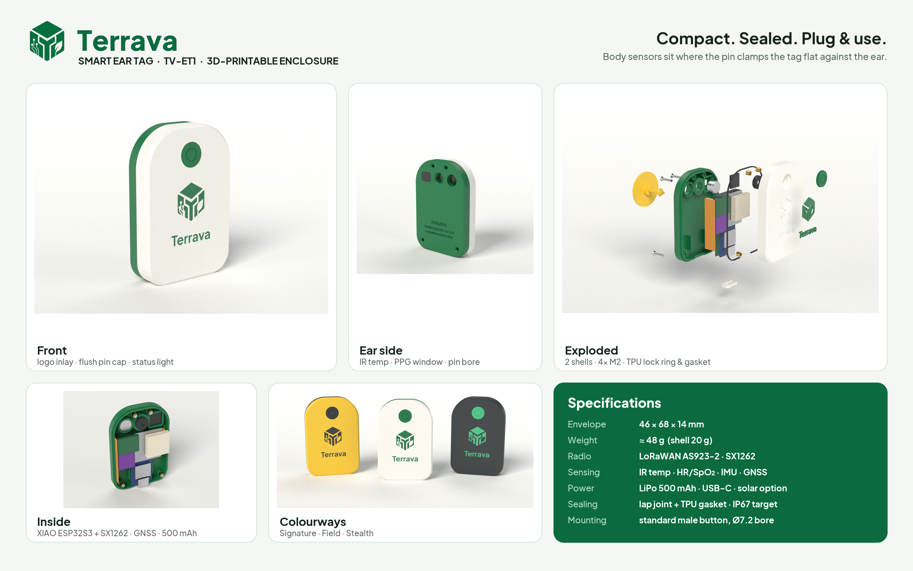
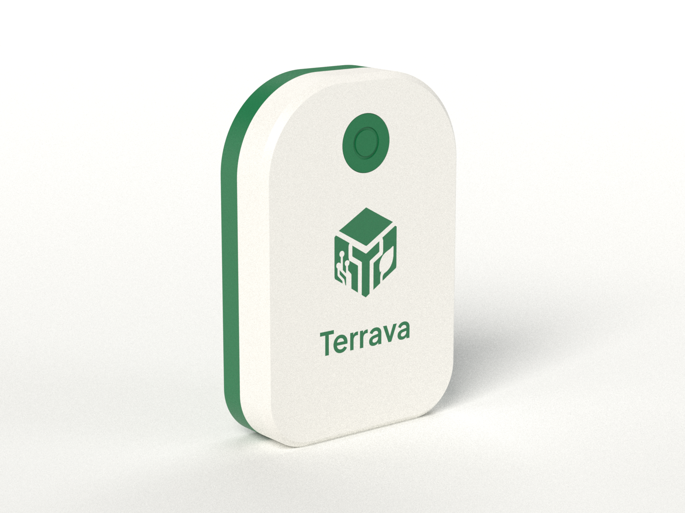
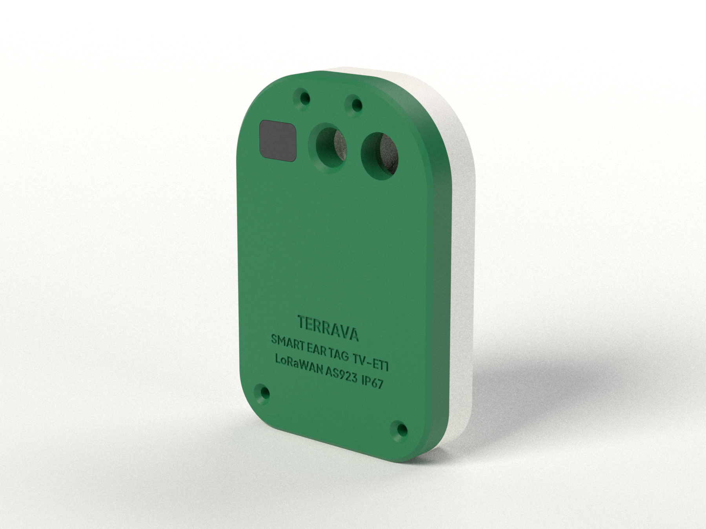
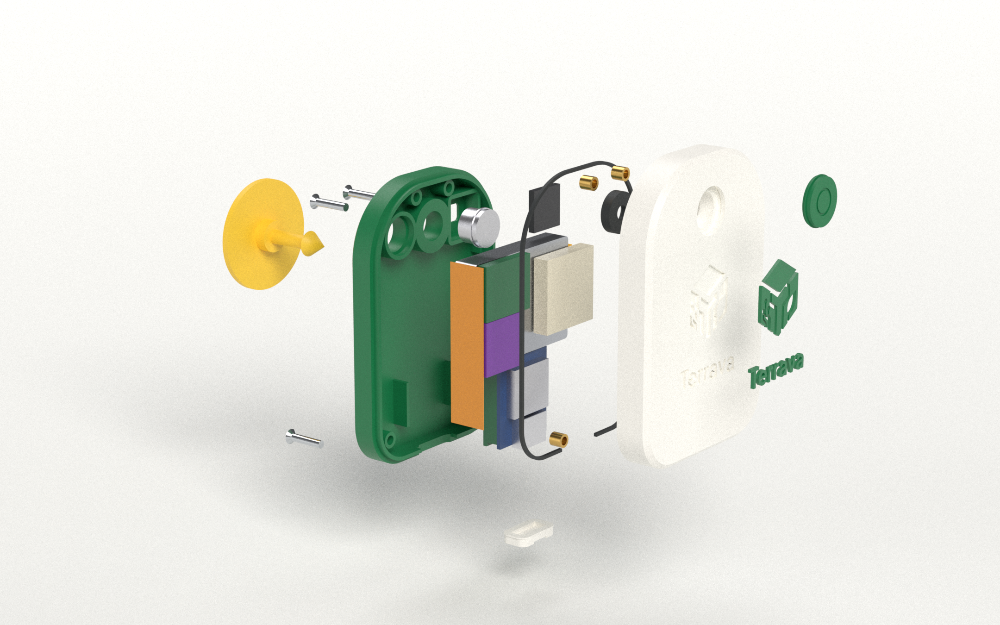
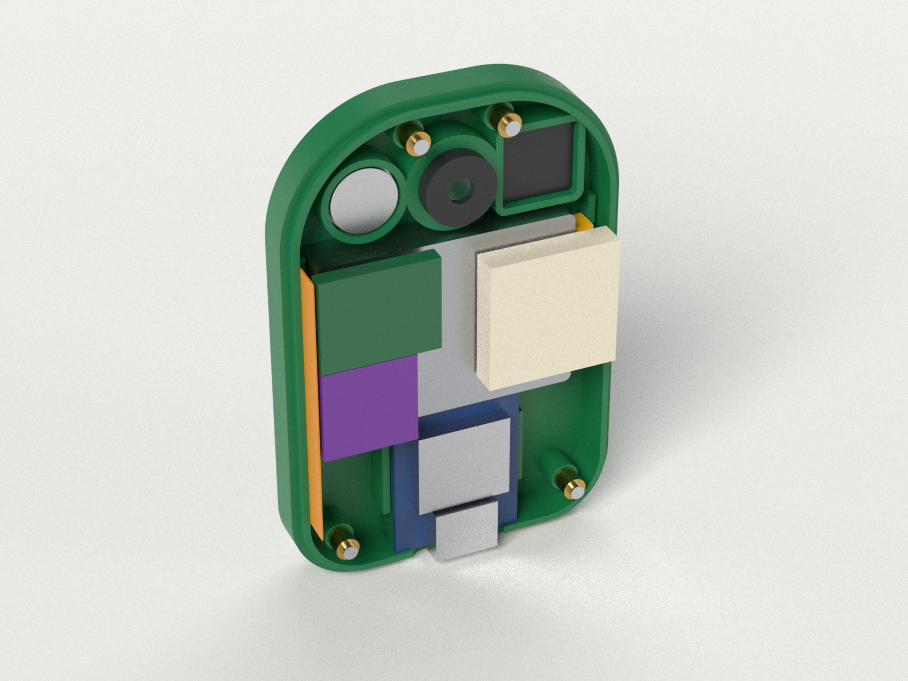
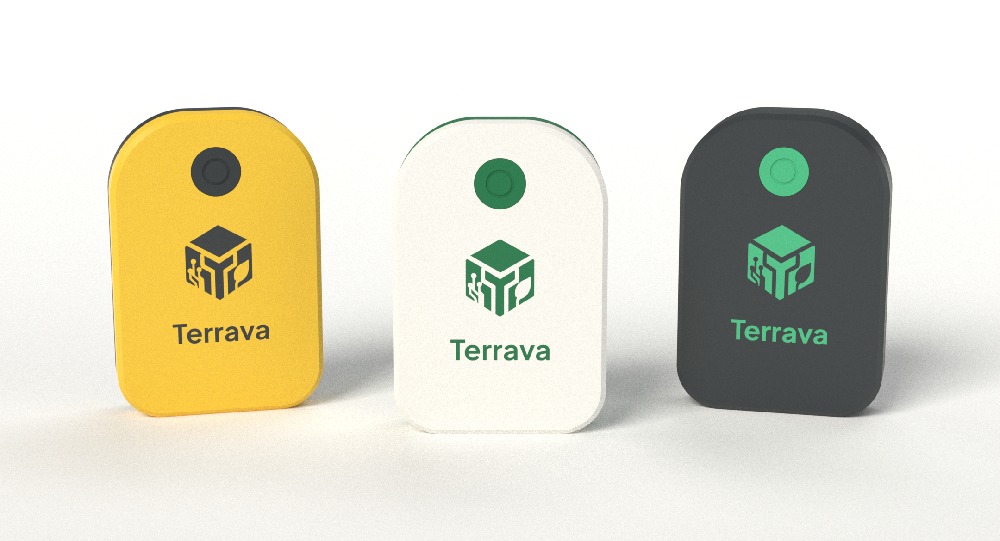
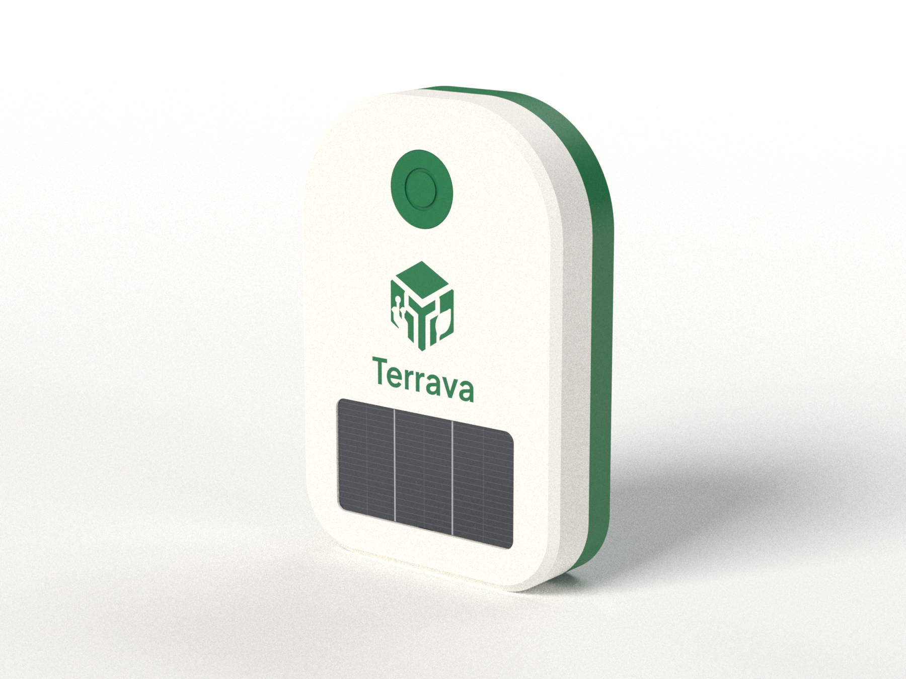

# Terrava Smart Ear Tag TV-ET1: spesifikasi casing

[🇬🇧 English](README.md) · Bagian dari [keluarga ear tag Terrava](../README-ind.md), bersama [TV-ET0 Classic](../tv-et0-classic/README-ind.md)

Casing ringkas, tertutup rapat, dan bisa dicetak 3D untuk smart ear tag Terrava. Casing ini memuat seluruh komponen IoT yang dipakai firmware di repositori ini (ESP32 + LoRa + suhu IR + PPG + IMU + GNSS), dipasang di telinga sapi memakai **male button ear tag standar dua bagian**, dan bersifat *plug & use*: isi daya lewat USB-C, tutup, daftarkan, pasang.

<p align="center"></p>

Semua isi folder ini berasal dari satu skrip CAD parametrik ([`cad/terrava_ear_tag.py`](cad/terrava_ear_tag.py)). File STL/STEP, render, gambar teknik, dan viewer 3D dihasilkan dari skrip tersebut, dan setiap komponen referensi diperiksa **tidak bertabrakan sama sekali** dengan casing.

---

## Ringkasan

| | |
| --- | --- |
| Dimensi | **46 × 68 × 14 mm** (bentuk perisai lembut, R10 di bawah, R18 di bahu) |
| Berat | **≈ 48 g** lengkap (part cetak 19,9 g + elektronik ≈ 27,7 g) |
| Casing | 2 bagian PETG atau ASA: rear shell 6,0 mm (sisi telinga) + front shell 8,0 mm, lap joint, gasket TPU, 4 × sekrup M2 stainless ke heat-set insert kuningan |
| Pemasangan | Lubang tembus Ø7,2 mm, 12,6 mm di bawah tepi atas; male button standar (pin ≈ 19 mm) dikunci ring TPU yang bisa diganti; tutup snap-in rata menyembunyikan ujung pin |
| Sensor tubuh | Termometer IR MLX90614 dan PPG MAX30102 di sisi telinga, 11,8 mm di kiri-kanan pin, tempat pin menjepit tag rata ke kulit |
| Elektronik | Seeed XIAO ESP32S3 + Wio-SX1262 (LoRaWAN AS923-2), modul GNSS + patch keramik 18 mm, IMU 6-axis, antena FPC LoRa |
| Daya | LiPo 602535 ≈ 500 mAh, pengisian USB-C (port ditutup plug TPU rata), opsi jendela solar 32 × 17 mm |
| Depan | Inlay logo dua warna yang rata (ikon + wordmark Terrava), lampu status yang berpendar menembus dinding 0,6 mm |
| Kedap air | Lap joint + gasket TPU tertekan + silikon di jendela sensor, **target desain IP67** (wajib diuji, lihat di bawah) |
| Volume dalam | 27 cm³; semua komponen referensi muat tanpa tumpang tindih pada pemeriksaan CAD |

## Render

| | |
| --- | --- |
|  |  |
| **Depan**: inlay logo, tutup pin rata, lampu status | **Sisi telinga**: jendela PPG, lubang pin, jendela IR MLX90614, sekrup M2 benam, ID terukir |
|  |  |
| **Exploded**: male button → sekrup → rear shell → elektronik → gasket/ring → front shell → inlay → tutup | **Bagian dalam** tanpa cover: stack XIAO + LoRa, baterai, patch dan modul GNSS, IMU, antena FPC, sensor tubuh |
|  |  |
| **Pilihan warna**: Field (mudah terlihat), Signature, Stealth | **Edisi solar**: jendela PV 32 × 17 mm, logo ringkas |

Ada juga render [terpasang di telinga](images/renders/07-mounted-on-ear.png) dan enam tampak ortografis untuk katalog (`images/renders/view-*.png`, latar transparan).

**3D interaktif:** buka [`terrava-ear-tag-3d-viewer.html`](terrava-ear-tag-3d-viewer.html) di browser untuk memutar model, meng-explode, menyembunyikan front shell atau elektronik, dan mengganti warna. Model sudah tertanam di file; hanya three.js dan font yang dimuat dari CDN.

## Gambar teknik

| Lembar | Isi |
| --- | --- |
| [1 · General arrangement](images/drawings/sheet-1-general-arrangement.png) ([PDF](images/drawings/sheet-1-general-arrangement.pdf)) | Tampak depan, samping, belakang, bawah, potongan A–A lewat pin, semua dimensi utama |
| [2 · Tata letak internal](images/drawings/sheet-2-internal-layout.png) ([PDF](images/drawings/sheet-2-internal-layout.pdf)) | Posisi komponen per lapisan, BOM, potongan nyata B–B / C–C / D–D dari CAD |
| [3 · Penempatan & pemasangan](images/drawings/sheet-3-placement-installation.png) ([PDF](images/drawings/sheet-3-placement-installation.pdf)) | Lokasi di telinga, cara pin mengunci, enam langkah plug & use |

---

## Alasan desain

**Ukuran.** Ukuran casing ditentukan dari komponen ke luar, bukan dari sketsa. Komponen tertinggi (stack XIAO + Wio-SX1262, ≈ 10 mm) menentukan tebal 14 mm. Stack 21 mm, baterai 25 mm, dan baris sensor 10 mm yang tersusun vertikal menentukan tinggi 68 mm. Lebar baterai ditambah dua kanal samping menentukan lebar 46 mm. Kotak pembatasnya kurang lebih sama dengan konsep 2025 berukuran 62 × 42 × 18 mm (≈ 44 vs 47 cm³), yang kini dibangun sebagai [TV-ET0 Classic](../tv-et0-classic/README-ind.md),, tetapi 4 mm lebih tipis sehingga menggantung lebih dekat ke telinga.

**Bentuk.** Bentuk perisai cembung tanpa leher: leher sempit adalah titik sobek pada panel tag, dan bagian atas yang lebar memberi ruang untuk dua sensor tubuh tepat di samping pin. Semua tepi dibulatkan atau di-chamfer, dan tidak ada bagian menonjol yang bisa tersangkut pagar atau tempat pakan; tutup, plug, jendela, dan sekrup semuanya rata.

**Penempatan.** Tag dipasang di **sepertiga tengah telinga, di antara dua rusuk tulang rawan**, jauh dari pembuluh darah besar dan tepi telinga (Oklahoma State University Extension; praktik terbaik Allflex). Terlalu dekat kepala berisiko nekrosis, terlalu dekat tepi berisiko sobek. Lembar 3 menunjukkannya dalam skala sebenarnya terhadap telinga ≈ 190 × 110 mm.

**Sensor di tempat yang tepat.** Pin menjepit tag ke telinga, jadi permukaan belakang di sekitar pin adalah satu-satunya area dengan kontak kulit yang andal. MLX90614 (non-kontak, FOV 90°) berada 0,3 mm di belakang permukaan telinga. MAX30102 melihat melalui jendela bening 1 mm yang rata. Patch GNSS menghadap ke luar di belakang logo, yang hanya berupa plastik tanpa cat logam.

**Bisa dicetak tanpa support.** Kedua shell dicetak dengan muka menghadap bed. Tepi depan dan belakang memakai chamfer 45° alih-alih fillet, jadi layer awal tidak melengkung. Kantong logo berada di 0,8 mm pertama, jadi printer multi-material bisa mencetak logo dua warna yang benar-benar rata.

## Elektronik referensi

| # | Komponen | Ukuran (mm) | Posisi |
| --- | --- | --- | --- |
| 1 | Seeed **XIAO ESP32S3** (MCU, charger Li-ion, USB-C) | 21 × 17,8 | bawah, setebal casing, USB-C di tepi bawah |
| 2 | Seeed **Wio-SX1262** untuk XIAO (LoRa/LoRaWAN, u.FL) | 21 × 17,8 | ditumpuk di bawah XIAO |
| 3 | **LiPo 602535** 3,7 V ≈ 500 mAh + PCM, JST-SH | 35 × 25 × 6 | lapisan sisi telinga, tengah |
| 4 | **Patch keramik** GNSS 18 × 18 × 4, u.FL | 18 × 18 × 4 | lapisan depan, menghadap keluar |
| 5 | Modul GNSS kelas **L76K / ATGM336H** | ≤ 16 × 13 × 2,4 | lapisan depan, kiri atas |
| 6 | Breakout **IMU** 6-axis (kelas MPU-6050) | ≤ 12,7 × 12,7 × 2,2 | lapisan depan, kiri |
| 7 | Termometer IR **MLX90614ESF**, kemasan TO-39 | Ø9,2 | sisi telinga, kiri pin |
| 8 | Modul mini **MAX30102** (HR + SpO₂) | ≤ 10 × 10 × 3,2 | sisi telinga, kanan pin |
| 9 | **Antena FPC** LoRa 915/923 MHz, u.FL | ≤ 40 × 10 × 0,2 | di dalam dinding kiri |

Semua kantong komponen adalah parameter di bagian atas skrip CAD. Jika modul Anda berbeda, ubah angkanya lalu jalankan ulang; pemeriksaan tabrakan akan memberi tahu jika ada yang tidak muat lagi.

> **Catatan firmware.** Firmware saat ini menargetkan LilyGO T-Beam (SX1276 + AXP192). T-Beam beserta sel 18650-nya tidak mungkin muat di casing seukuran ear tag, jadi casing ini memakai form factor XIAO. Porting berarti mengubah pin map di `config.h`, memakai kelas `SX1262` RadioLib sebagai ganti `SX1276`, dan membaca baterai lewat pembagi tegangan ke ADC sebagai ganti AXP192. Kode sensor dan protokol tidak berubah. **XIAO nRF52840** muat di kantong yang sama dan menjadi jalur peningkatan hemat daya (lihat Anggaran daya).

## Part cetak

File STL di [`models/stl/`](models/stl) sudah dalam orientasi cetak. File STEP di [`models/step/`](models/step) dalam posisi rakitan, ditambah satu file rakitan lengkap dengan nama dan warna per part.

| File | Material | Jml | Catatan |
| --- | --- | --- | --- |
| `01-rear-shell-base` | PETG / ASA | 1 | sisi telinga menghadap bed, tanpa support |
| `02-front-shell-cover` | PETG / ASA | 1 | muka depan menghadap bed PEI bertekstur, tanpa support |
| `02s-front-shell-cover-solar` | PETG / ASA | — | cover alternatif dengan cekungan PV 32 × 17 × 1,0 mm |
| `03a-logo-inlay-multimaterial` | PETG / ASA hijau | 1 | muat bersama cover sebagai **satu objek, dua part**, lalu pilih filamen hijau |
| `03b-logo-inlay-press-fit` | PETG / ASA hijau | (1) | opsi single-extruder: 0,06 mm lebih kecil, cetak datar, tekan masuk dengan setetes lem CA |
| `04-pin-cap-TPU` | TPU 95A | 1 | snap-in, menyembunyikan ujung pin |
| `05-pin-lock-ring-TPU` | TPU 95A | 1 (+ cadangan) | mencengkeram ujung panah male pin; ganti setiap kali tag dipasang ulang |
| `06-gasket-TPU` | TPU 95A | 1 | 0,8 mm, tertekan menjadi 0,6 mm |
| `07-usb-c-plug-TPU` | TPU 95A | 1 (+ cadangan) | plug rata dengan bead pengunci dan alur tarik |
| `08-ppg-window-clear` | PC / akrilik bening | 1 | paling baik dipotong dari PC bening 1 mm; PETG bening hasil cetak membuyarkan cahaya |

**Setelan cetak:** nozzle 0,4 mm, layer 0,16 mm, 5 perimeter (dinding 1,6–2,0 mm tercetak padat), 6 layer atas dan bawah, gyroid 40 % di dalam boss, ironing mati. Pakai **ASA** untuk ketahanan UV terlama di bawah matahari, atau PETG. Hindari PLA: PLA melunak di atas sekitar 50 °C, suhu yang bisa dicapai tag gelap di bawah matahari tropis. Part TPU: 25 mm/s, infill 100 %.

## Hardware

| Item | Jml |
| --- | --- |
| Sekrup benam M2 × 10, stainless A2 (DIN 965 / ISO 7046) | 4 |
| Heat-set insert kuningan M2 × 3 (lubang Ø3,2 mm) | 4 |
| **Male button** ear tag sapi standar (mis. Allflex Global/Universal male, pin ≈ 19 mm) + aplikator | 1 per ekor |
| Silikon netral (jendela sensor, opsional bead gasket), selotip Kapton, foam pad 0,4 mm | — |

## Perakitan

1. Tekan 4 heat-set insert ke boss front shell dengan solder bersuhu 220 °C.
2. Tekan ring kunci TPU ke kantongnya di dalam boss pin front shell.
3. Pasang jendela PPG di rear shell (beri cincin tipis epoksi bening atau silikon di tepinya).
4. Pasang MLX90614 (kaleng masuk ke lubang Ø8,4, flange di dudukan) dan modul MAX30102 (sensor menempel di jendela). Segel keduanya dari dalam dengan silikon.
5. Letakkan baterai di antara pemandu sudut, lalu stack XIAO + Wio di atas foam pad 0,4 mm dengan USB-C pas di port.
6. Tempel antena FPC di dinding kiri, lalu patch GNSS (di dalam bingkainya), modul GNSS, dan IMU di sisi dalam front shell. Rapikan kabel u.FL serta kabel I²C/UART.
7. Flash dan uji di meja kerja (`pio run -t upload`, lalu `python -m terrava_iot decode …` pada satu uplink).
8. Letakkan gasket di lip base, tutup kedua shell, kencangkan 4 sekrup secara merata (pas, sekitar 0,15 N·m).
9. Tekan plug USB hingga rata.

## Plug & use (di lapangan)

1. **Isi daya** lewat USB-C. Lampu status berpendar menembus casing.
2. **Tutup**: tekan plug TPU hingga rata.
3. **Daftarkan** DevEUI di Terrava → Devices dan pasangkan dengan ternak (alur sama seperti [`iot/README.md`](../../README.md)).
4. **Siapkan**: lepas tutup, pasang tag di rahang female aplikator, dan pasang male button di pinnya.
5. **Pasang**: disinfeksi, lalu tekan dengan satu gerakan mantap di sepertiga tengah di antara rusuk telinga. Desain menyisakan celah 2–4 mm untuk pertumbuhan telinga dan sirkulasi udara.
6. **Tutup & jalan**: pasang tutupnya. Tag bergabung ke LoRaWAN dan melapor dalam satu interval.

Melepas: potong male pin, dorong tutup keluar dari belakang, lalu pasang ring kunci baru.

## Anggaran daya (estimasi)

| Profil | Asumsi | Konsumsi | Ketahanan dengan 500 mAh (80 % terpakai) |
| --- | --- | --- | --- |
| Default firmware | interval 5 menit, aktif 15 dtk pada ~45 mA, GPS tiap 3 siklus | ≈ 85 mAh/hari | ≈ 5 hari |
| **Profil lapangan** | interval 15 menit, aktif ~6 dtk, FIFO IMU untuk aktivitas, GPS tiap jam (hot start), sensor di jalur daya yang bisa diputus | ≈ 9 mAh/hari | ≈ 45 hari |
| Profil lapangan + edisi solar | sel 5,4 cm², tag vertikal menerima ~10 % insolasi horizontal | +5 s/d +10 mAh/hari terpanen | mendekati netral energi di padang terbuka |
| Profil lapangan + XIAO nRF52840 | kantong sama, tidur ~5 µA, aktif ~8 mA | ≈ 3 mAh/hari | 4 bulan atau lebih, melampaui target 60–80 hari |

Angka ini untuk perencanaan. Ukur pada rakitan nyata dengan pencatat arus (misalnya Nordic PPK2).

## Berat

Shell 19,0 g, inlay, tutup, ring, gasket, plug, dan jendela 0,9 g, elektronik ≈ 27,7 g (baterai 10 g, XIAO + LoRa 5,5 g, GNSS 5,5 g, sisanya di bawah 7 g), total **≈ 48 g**. Berat ini wajar untuk sapi muda dan dewasa (≥ 250 kg), tetapi lebih berat dari tag visual biasa. Untuk pedet, buat varian lite (tanpa GNSS, 300 mAh) sekitar 35 g. PCB kustom adalah jalan menuju sekitar 30 g.

## Daftar validasi sebelum dipakai di lapangan

- [ ] Uji kecocokan satu set shell hasil cetak dengan modul Anda yang sebenarnya (ukuran kantong adalah parameter)
- [ ] Kecocokan male button: ujung panah lolos lubang Ø7,2 dan ring kunci; gaya cabut harus di atas 100 N
- [ ] Uji rendam 1 m selama 30 menit dengan tisu kering di dalamnya (target IP67)
- [ ] Uji RF: bandingkan RSSI/SNR dengan antena referensi; geser posisi FPC jika perlu
- [ ] Kalibrasi sensor: offset IR (`TEMP_CAL_OFFSET_C`) terhadap suhu rektal; kualitas kontak PPG
- [ ] Uji jatuh dari 1,5 m ke beton, dan oven 70 °C selama 1 jam (beban panas matahari)
- [ ] Kesejahteraan hewan: amati telinga setiap hari selama satu minggu pada kelompok uji coba

## Membangun ulang semuanya

```bash
cd iot/ear-tag-specifications/tv-et1-shield/cad
python -m venv .venv && .venv/Scripts/activate       # macOS/Linux: source .venv/bin/activate
pip install -r requirements.txt
python trace_logo.py          # images/logo.png -> terrava_logo.json (hanya jika logo berubah)
python terrava_ear_tag.py     # CAD + cek tabrakan/berat -> models/ (STEP, STL, GLB)
python drawings.py            # -> images/drawings/ (PNG + PDF)
python render.py              # -> images/renders/ (Mitsuba 3, CPU; ~90 menit kualitas penuh)
python compose_overview.py    # -> images/00-terrava-ear-tag-overview.png
python build_viewer.py        # -> terrava-ear-tag-3d-viewer.html
```

`python terrava_ear_tag.py --check` hanya mencetak laporan tabrakan dan berat (`models/build-report.json`).

## Struktur folder

```
ear-tag-specifications/tv-et1-shield/
├── README.md / README-ind.md
├── terrava-ear-tag-3d-viewer.html     model interaktif (bisa offline)
├── cad/                               sumber parametrik + toolchain
│   ├── terrava_ear_tag.py             model CadQuery, pemeriksaan, ekspor
│   ├── render.py · drawings.py · compose_overview.py · build_viewer.py
│   ├── trace_logo.py · terrava_logo.json/.svg   logo Terrava dalam vektor
│   └── fonts/                         Plus Jakarta Sans (SIL OFL)
├── models/
│   ├── stl/                           part siap cetak
│   ├── step/                          part + rakitan berwarna
│   ├── terrava-ear-tag-assembly.glb
│   └── build-report.json              laporan tabrakan + berat
└── images/
    ├── 00-terrava-ear-tag-overview.png
    ├── renders/                       render fotorealistik + tampak katalog
    └── drawings/                      lembar gambar A3 (PNG + PDF)
```

## Referensi

- Oklahoma State University Extension, [Livestock tagging](https://extension.okstate.edu/fact-sheets/livestock-tagging): penempatan di sepertiga tengah, di antara rusuk telinga
- SRUC, [Implication of smart ear tags' material, shape, weight and placement](https://pure.sruc.ac.uk/en/publications/implication-of-smart-ear-tags-material-shape-weight-and-placement/): tag yang lebih ringan dan ringkas mengurangi telinga turun dan tag lepas
- Allflex, [Button Male (M1)](https://www.allflex.global/product/button-male-m1): kepala male button 28 mm; [data uji ICAR](https://www.icar.org/?p=1687) untuk panjang pin male
- Seeed Studio, [XIAO ESP32S3 & Wio-SX1262 kit](https://wiki.seeedstudio.com/wio_sx1262_with_xiao_esp32s3_kit/): form factor 21 × 18 mm
